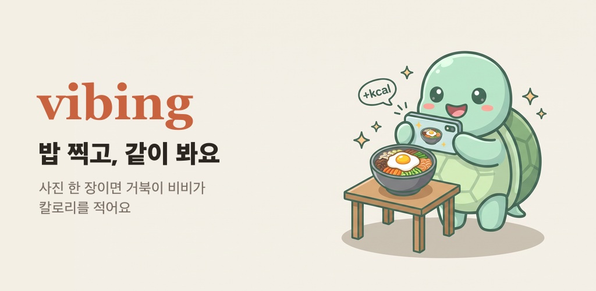
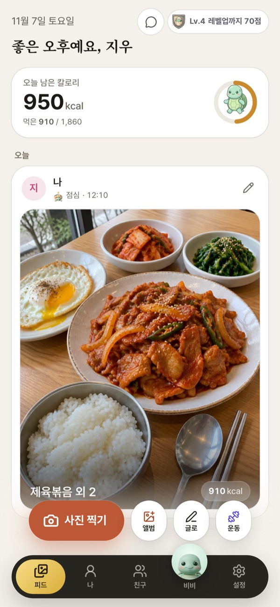
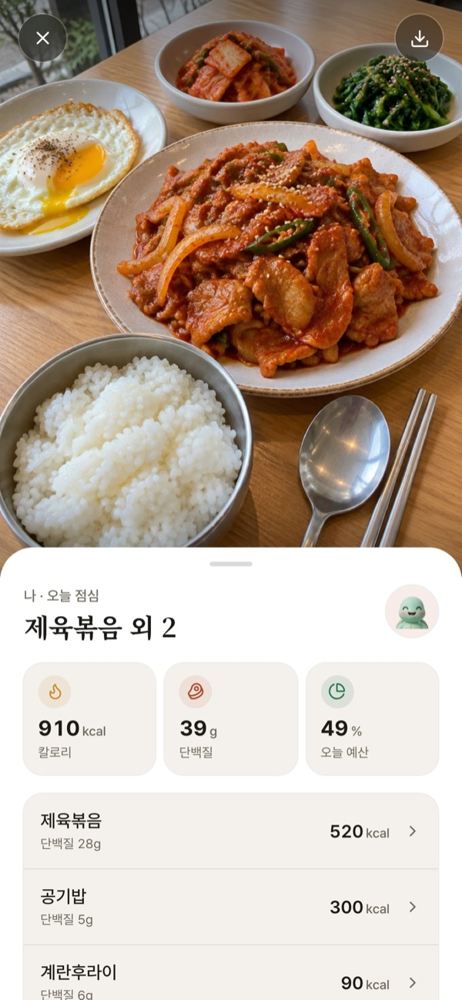
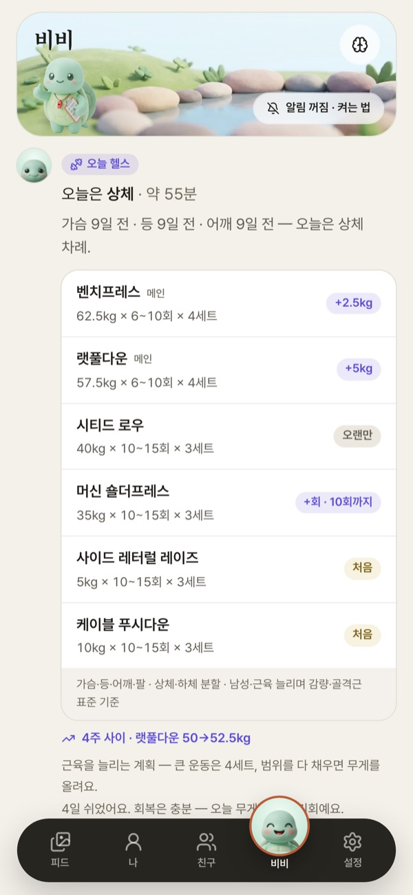
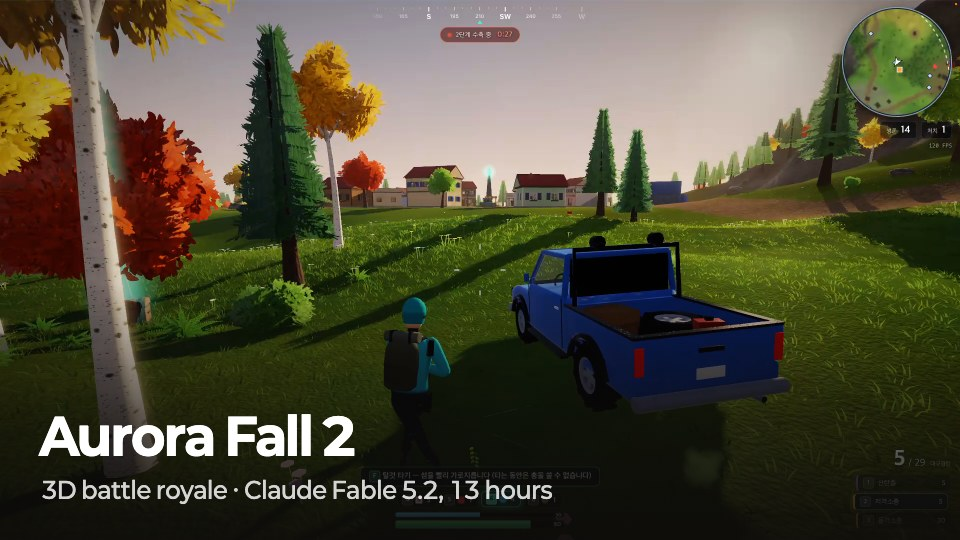
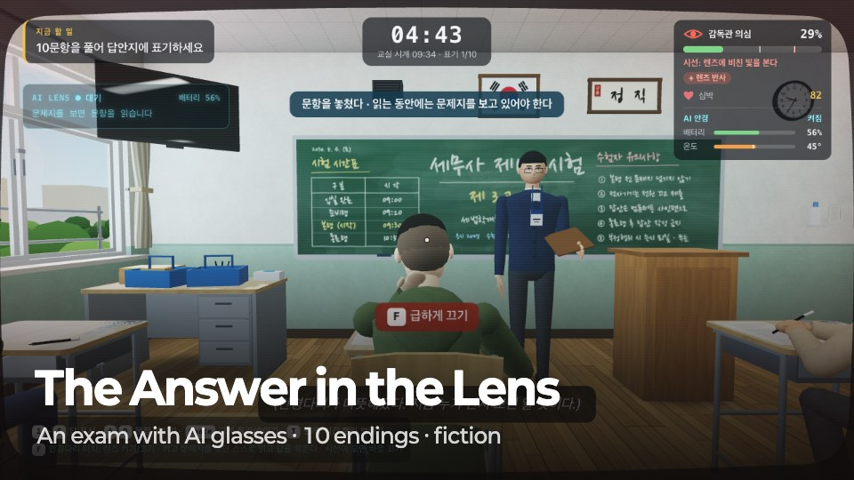
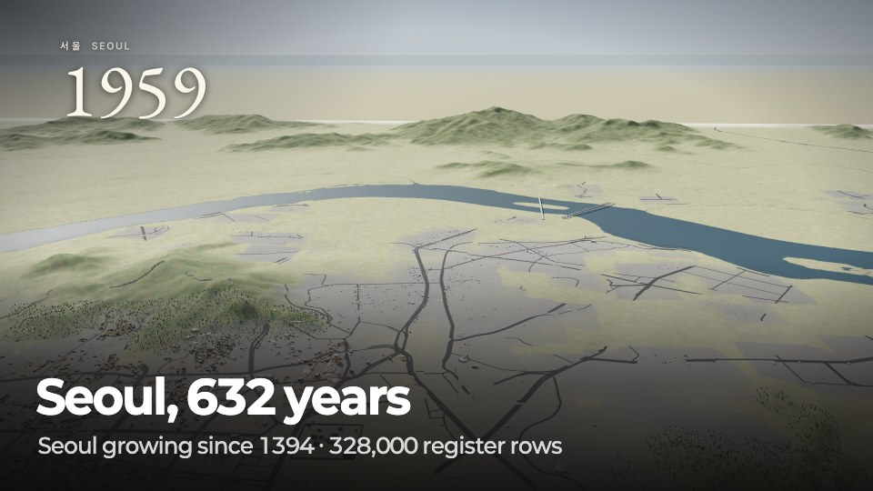
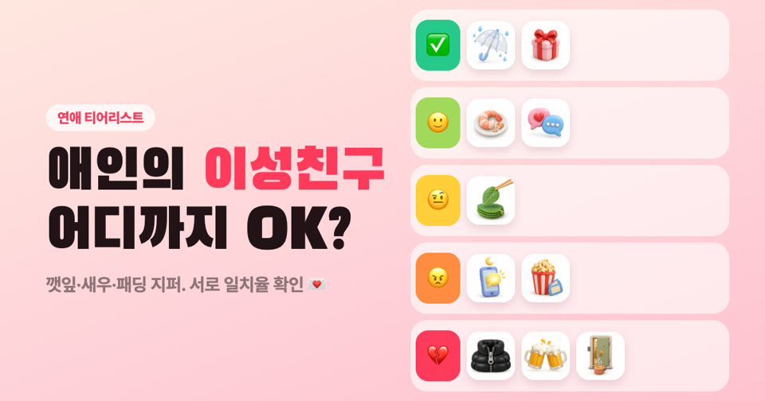

[한국어](README.md) · English

 

## What I'm building now

### vibing

  

Snap a photo of what you eat and a turtle coach named **Bibi** logs the calories and protein. Bibi also plans the day's gym session. It sets the weights from your sex, muscle mass and a photo of your InBody sheet, tells you the next set while you rest, and remembers the exercises you'd rather skip. You and your friends see each other's meals. It's my eleventh weight-loss or fitness app, and the first one to reach a store.

  
  
  

  

<a href="https://apps.apple.com/kr/app/id6815520523">On the App Store</a> since October 2026 · Google Play in closed testing · Next.js · Supabase · Capacitor · records on screen are from a test account

 

### AI game battles

I ask an AI for a game in a few lines, play what it builds, and post the result on YouTube. Twice I gave two AIs the same one-line prompt and let them compete, and once the winner got an extra day. The code is published exactly as the AI wrote it. Click a picture and it runs in the browser. The games are in Korean.

  
  
  
  

November 2026 · no-build HTML · PC keyboard and mouse · <a href="https://wonjangcloud9.github.io/ai-game-battle/">see all of them, including the ones GPT-6 made</a> · <a href="https://github.com/wonjangcloud9/ai-game-battle">code</a>

 

## nanika · 100 services

The plan was one small web service a day, each posted as an Instagram Reel, until I reached 100. I made eight in four days and closed shop. They're all still up, so click one and try it.

  
  
  
  
  
  
  
  
  

The one I spent longest on is #006, the museum. I built a three-story hall and ten galleries in three.js and hung all 369 of Korea's National Treasures in them. The services are in Korean.

September 2026 · one HTML file each, no build step · three.js · GitHub Pages

 

<b>Six open-source tools</b>

 

- **[notdone](https://github.com/wonjangcloud9/notdone)** A Claude Code skill that asks for evidence when an agent says "done" without ever looking at the screen
- **[wj-mods](https://github.com/wonjangcloud9/wj-mods)** Claude Code mods that put per-session progress, usage, long-turn alerts and session nicknames in the terminal
- **[claude-tree](https://github.com/wonjangcloud9/claude-tree)** Runs several Claude Code sessions in parallel, each in its own git worktree
- **[open-guardrail](https://github.com/wonjangcloud9/open-guardrail)** Guardrails for LLM apps. Zero API calls, under 0.1ms
- **[wonjangAgent](https://github.com/wonjangcloud9/wonjangAgent)** A Korean-first autonomous AI agent. Single Rust binary
- **[harness-eval](https://github.com/wonjangcloud9/harness-eval)** A CLI that puts a number on how much the harness changes results

 

## The path so far

<picture>
  <source media="(prefers-color-scheme: dark)" srcset="./assets/dashboard-dark-98a7590bc5.svg">
  
</picture>

 

<table>
<tr><td width="92" align="center"><b>2019</b> 2 repos</td><td>
First commit. I started by cloning KakaoTalk and Netflix.
</td></tr>
<tr><td align="center"><b>2020–21</b> 385 commits</td><td>
The years I didn't use GitHub. I didn't know it mattered, so the code stayed on my laptop. <b>Zero commits in 2020.</b>
</td></tr>
<tr><td align="center"><b>2022</b> 91 repos 1,160 commits</td><td>
React, Next.js and Django. I cloned Karrot Market, Airbnb and Twitter, eight repos a month.
</td></tr>
<tr><td align="center"><b>2023</b> 116 repos 1,894 commits</td><td>
<b>My busiest year for repos.</b> Flutter, React Native and Jetpack Compose at once, plus my first real product attempts: a toilet finder, an education LMS, a complaint tracker and an AI companion.
</td></tr>
<tr><td align="center"><b>2024</b> 48 repos 1,314 commits</td><td>
LangChain and RAG put an LLM in a product for the first time.
</td></tr>
<tr><td align="center"><b>2025</b> 45 repos 852 commits</td><td>
Five health apps. Late in the year I stopped using other people's agents and <b>started writing my own</b>.
</td></tr>
<tr><td align="center"><b>2026</b> 44 repos 3,640 commits</td><td>
Shipped agent tools to npm and PyPI. In September I opened eight web services in four days with nanika; in October vibing went out on the App Store. In November I had AI build games and opened six of them. <b>My highest-commit year, and it's only November.</b>
</td></tr>
</table>

## Subjects I kept coming back to

<b>How many repos each, and how far they got</b>

 

| Subject | Repos | How far it got |
|---|---|---|
| 🤖 **Agents & LLMs** | 26 | Following courses → writing my own → **four packages on npm and PyPI** |
| 🏃 **Weight & fitness** | 11 | The eleventh, vibing, is the first to reach the App Store. The first ten taught me what to cut |
| 🎌 **Fandom & Japanese** | 7 | Consolidated into [custo](https://wonjangcloud9.github.io/custo/) |
| ⏱️ **Pomodoro** | 6 | One per new framework I picked up |
| 🎵 **TikTok clones** | 3 | Where I actually learned Flutter animations |
| 😴 **Sleep** | 3 | [Jammanbo](https://life-save-with-claude-code-multi-se.vercel.app) is the one that stuck |

I tend to stay on one subject for a long time.

## Tools

TypeScript · Next.js · React · Capacitor · Python · Rust · Flutter · Supabase · PostgreSQL · three.js · Claude Code

 

<!-- contributions:start -->
## Contributions to other people's projects

Problems I hit while using a tool, fixed or reported. Many only show up when you work in Korean, such as IME input and Korean captions. 37 pull requests and 14 issues across 13 projects, 6 merged so far.

| Project | What it is | Mine |
|---|---|---|
| **[hyperframes](https://github.com/heygen-com/hyperframes)** ★ 84k | Framework that renders HTML, CSS and GSAP to video frame by frame in headless Chrome, with a CLI linter and checker (TypeScript) | PR 24 (5 merged) 8 issues |
| **[hermes-agent](https://github.com/NousResearch/hermes-agent)** ★ 263k | Autonomous AI agent for the terminal, desktop and chat apps, with a dashboard and an agent-to-agent server (Python) | PR 5 |
| **[Ant-Media-Server](https://github.com/ant-media/Ant-Media-Server)** ★ 4.7k | Streaming server with ~0.5 s latency over WebRTC (Java) | 2 issues |
| **[nlutter-study-2nd](https://github.com/nlutter-study/nlutter-study-2nd)** ★ 1 | Homework repo of a Flutter study group | PR 2 (1 merged) |
| **[bloom](https://github.com/safety-research/bloom)** ★ 1.4k | Pipeline that automatically evaluates how often an LLM shows a given behaviour (Python) | 2 issues |
| **[learnharness](https://github.com/amosblomqvist/learnharness)** ★ 9.4k | Agent harness for learning difficult things (TypeScript) | PR 1 |
| **[awesome-claude-plugins](https://github.com/composio-community/awesome-claude-plugins)** ★ 2.0k | Curated list of Claude Code plugins | PR 1 |
| **[expo](https://github.com/expo/expo)** ★ 54k | Framework and build service for Android, iOS and web apps in React | 1 issue |
| **[Fuse](https://github.com/krisk/Fuse)** ★ 21k | Lightweight fuzzy-search library (JavaScript) | PR 1 |
| **[plyr](https://github.com/sampotts/plyr)** ★ 30k | HTML5, YouTube and Vimeo media player (JavaScript) | 1 issue |
| **[kit](https://github.com/sveltejs/kit)** ★ 21k | Svelte's full-stack web framework: routing, SSR, redirects | PR 1 |
| **[es-toolkit](https://github.com/toss/es-toolkit)** ★ 11k | Toss's small, fast utility library that replaces lodash (TypeScript) | PR 1 |
| **[validator.js](https://github.com/validatorjs/validator.js)** ★ 24k | String validation library: emails, passport numbers and so on (JavaScript) | PR 1 |

**Merged**

- [hyperframes #7700](https://github.com/heygen-com/hyperframes/pull/7700) fix(lint): say the audio overlap warning is about a shared Studio lane
- [hyperframes #7699](https://github.com/heygen-com/hyperframes/pull/7699) fix(check): name a color-graded video by its own selector in layout findings
- [hyperframes #7697](https://github.com/heygen-com/hyperframes/pull/7697) fix(cli): the render header names the quality preset and CRF it encodes with
- [hyperframes #7689](https://github.com/heygen-com/hyperframes/pull/7689) fix(cli): stop the CLI build looking for the removed gsap skill
- [hyperframes #7608](https://github.com/heygen-com/hyperframes/pull/7608) fix(cli): quote the project name in init's printed `cd` commands
- [nlutter-study-2nd #4](https://github.com/nlutter-study/nlutter-study-2nd/pull/4) add .gitignore

<b>31 pull requests in review</b>

 

- [hyperframes #7752](https://github.com/heygen-com/hyperframes/pull/7752) fix(check): mark a contrast finding by its severity and quote its text
- [validator.js #2962](https://github.com/validatorjs/validator.js/pull/2962) fix(isPassportNumber): accept South Korea's next-generation passport numbers
- [hyperframes #7705](https://github.com/heygen-com/hyperframes/pull/7705) fix(check): a nested line's words stay out of the line around it
- [hyperframes #7704](https://github.com/heygen-com/hyperframes/pull/7704) fix(check): time a line the next scene repeats in place as one line
- [hyperframes #7703](https://github.com/heygen-com/hyperframes/pull/7703) fix(check): line_unread names the captions track that exempts a caption
- [hyperframes #7701](https://github.com/heygen-com/hyperframes/pull/7701) fix(lint): keep separate count-up objects apart in the repeated fromTo check
- [hyperframes #7698](https://github.com/heygen-com/hyperframes/pull/7698) fix(check): keep the outline a word inherits from its caption in contrast
- [hyperframes #7696](https://github.com/heygen-com/hyperframes/pull/7696) fix(lint): warn when a video's slot outlasts its source
- [hyperframes #7695](https://github.com/heygen-com/hyperframes/pull/7695) fix(cli): a low-disk render refusal names the extracted-frame cache and clean
- [hyperframes #7694](https://github.com/heygen-com/hyperframes/pull/7694) docs: credit the OpenStreetMap and CARTO sources of the korea-map block asset
- [hyperframes #7693](https://github.com/heygen-com/hyperframes/pull/7693) docs(skills): say a variable must be declared before data-var-* binds it
- [hyperframes #7692](https://github.com/heygen-com/hyperframes/pull/7692) docs(skills): say a later fromTo needs immediateRender: false
- [hyperframes #7691](https://github.com/heygen-com/hyperframes/pull/7691) fix(cli): say init's skills install is global and how to skip it
- [hyperframes #7690](https://github.com/heygen-com/hyperframes/pull/7690) fix(registry): caption components group a replaced transcript instead of crashing
- [hyperframes #7688](https://github.com/heygen-com/hyperframes/pull/7688) fix(cli): doctor stops reporting a failure when only optional checks are missing
- [Fuse #861](https://github.com/krisk/Fuse/pull/861) fix(diacritics): compose Hangul back after stripping, so Korean search keeps working
- [learnharness #698](https://github.com/amosblomqvist/learnharness/pull/698) fix: leave Enter and Escape to an IME composition in rename and folder fields
- [hermes-agent #153803](https://github.com/NousResearch/hermes-agent/pull/153803) fix(desktop): leave Enter and Escape to an IME composition in log and page search
- [hyperframes #7564](https://github.com/heygen-com/hyperframes/pull/7564) fix(cli): size exported caption cues by display width, so CJK cues fit like Latin ones
- [hermes-agent #153677](https://github.com/NousResearch/hermes-agent/pull/153677) fix(bot-mode): print a teammate's reply as text, not \uXXXX escapes
- [hyperframes #7559](https://github.com/heygen-com/hyperframes/pull/7559) fix(cli): refuse SRT and VTT files that are not UTF-8 instead of importing mojibake
- [hyperframes #7558](https://github.com/heygen-com/hyperframes/pull/7558) fix(registry): split typed and falling text by grapheme, not UTF-16 unit
- [kit #17717](https://github.com/sveltejs/kit/pull/17717) fix: percent-encode non-ASCII characters in redirect locations
- [hermes-agent #152043](https://github.com/NousResearch/hermes-agent/pull/152043) fix(a2a): reject a non-ASCII bearer token with 401 instead of crashing
- [hermes-agent #152042](https://github.com/NousResearch/hermes-agent/pull/152042) fix(kanban): leave Enter and Escape to an in-flight IME composition
- [hermes-agent #152023](https://github.com/NousResearch/hermes-agent/pull/152023) fix(dashboard): leave Enter and Escape to an in-flight IME composition
- [es-toolkit #2209](https://github.com/toss/es-toolkit/pull/2209) fix[compat/truncate]: count emoji sequences as one character like Lodash
- [hyperframes #7449](https://github.com/heygen-com/hyperframes/pull/7449) fix(studio): leave Enter and Escape to an IME that is still composing
- [hyperframes #7409](https://github.com/heygen-com/hyperframes/pull/7409) feat(check): warn when a line break cuts a Korean word in two
- [awesome-claude-plugins #571](https://github.com/composio-community/awesome-claude-plugins/pull/571) Add wj-mods to Developer Productivity
- [nlutter-study-2nd #9](https://github.com/nlutter-study/nlutter-study-2nd/pull/9) Day12 settings

<b>14 issues reported</b>

 

- [hyperframes #7753](https://github.com/heygen-com/hyperframes/issues/7753) check: a contrast finding on an id-less element is named from <body>, past ancestors that have an id
- [hyperframes #7713](https://github.com/heygen-com/hyperframes/issues/7713) Render progress bar sits at 77% when 95% of a long streaming render is done
- [hyperframes #7712](https://github.com/heygen-com/hyperframes/issues/7712) check: container_overflow "Nowrap text is wider than its container" fires for absolutely positioned titles in an unsized wrapper
- [hyperframes #7711](https://github.com/heygen-com/hyperframes/issues/7711) check: text hidden under an opaque cover is reported twice, as text_occluded and as a contrast failure against the cover
- [hyperframes #7710](https://github.com/heygen-com/hyperframes/issues/7710) check: text_below_floor repeats one style's finding once per scene file (74 warnings for one 27 px label class)
- [hyperframes #7709](https://github.com/heygen-com/hyperframes/issues/7709) check: line_unread reports every text chunk of a closing card as "the film's last line"
- [hyperframes #7707](https://github.com/heygen-com/hyperframes/issues/7707) New-project AGENTS.md tells agents to run `npm run check`, which the check docs say never to do
- [hyperframes #7706](https://github.com/heygen-com/hyperframes/issues/7706) check: a media-metadata rebind rewinds scene timelines to 0 between a seek and its read, so findings change between identical runs
- [bloom #28](https://github.com/safety-research/bloom/issues/28) Noisy LiteLLM debug messages pollute output
- [bloom #27](https://github.com/safety-research/bloom/issues/27) Pipeline hangs silently when API keys are missing
- [expo #25561](https://github.com/expo/expo/issues/25561) Apk made with EAS, expo 49 version of easy does not allow api calls
- [Ant-Media-Server #4267](https://github.com/ant-media/Ant-Media-Server/issues/4267) Self-camera switching
- [plyr #2434](https://github.com/sampotts/plyr/issues/2434) mobile player Error
- [Ant-Media-Server #3989](https://github.com/ant-media/Ant-Media-Server/issues/3989) A phenomenon in which the microphone and speaker function of Bluetooth earphones go to a mobile phone when connecting webrtc with Javascript using peer.html while using Bluetooth earphones.

<!-- contributions:end -->

 

<picture>
  <source media="(prefers-color-scheme: dark)" srcset="https://raw.githubusercontent.com/wonjangcloud9/wonjangcloud9/output/snake-dark.svg">
  
</picture>

195 of my 354 repos are private because they hold keys or personal data. The numbers above include private commits.

