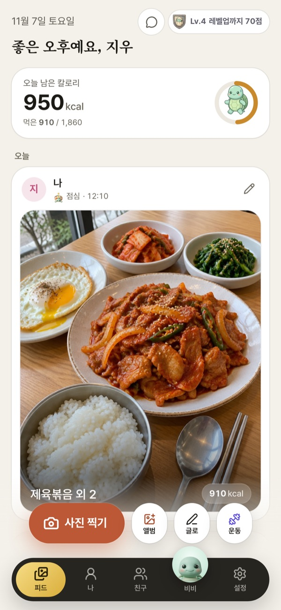
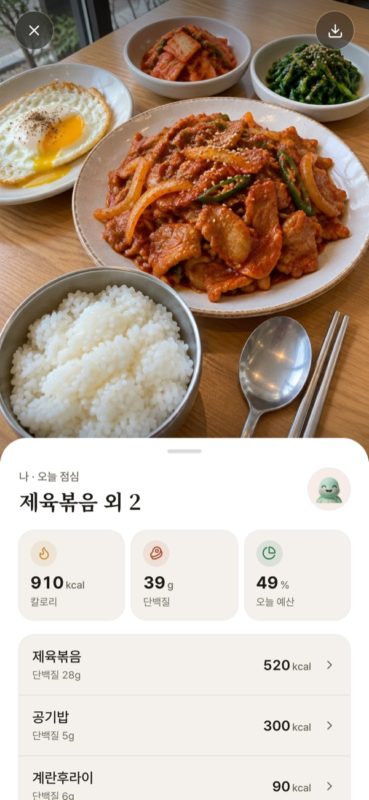
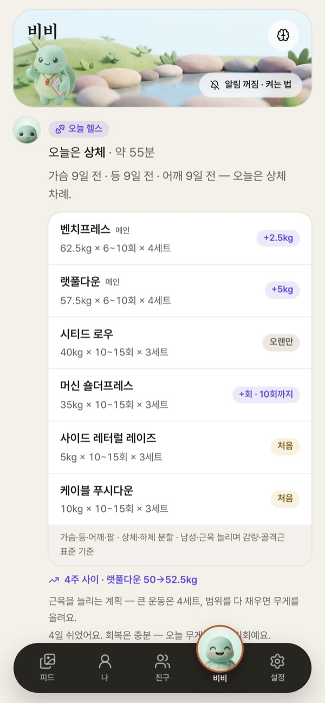
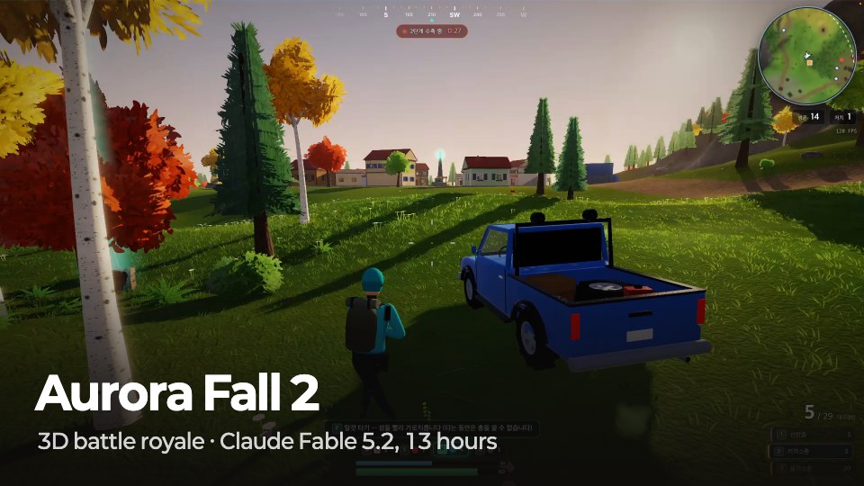
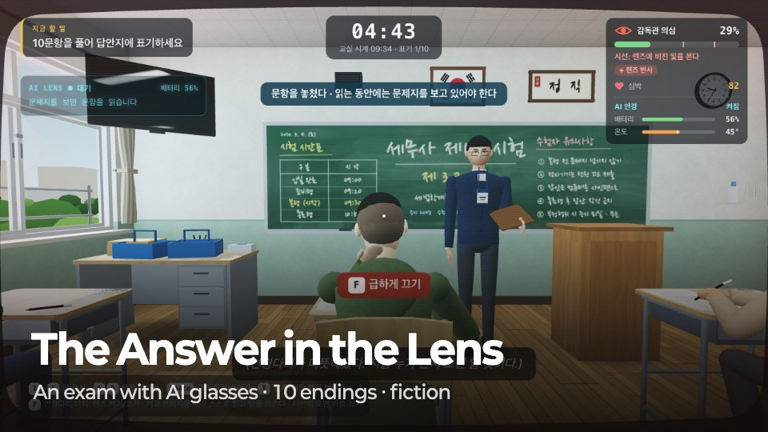
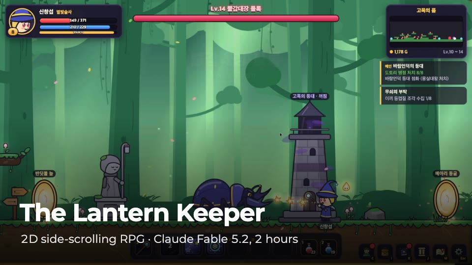
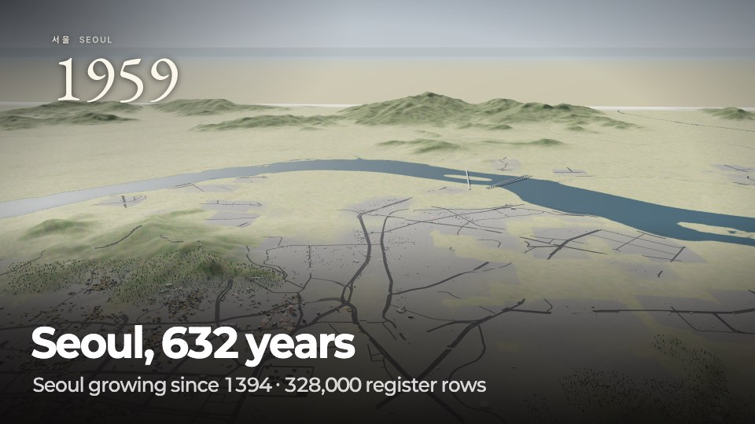
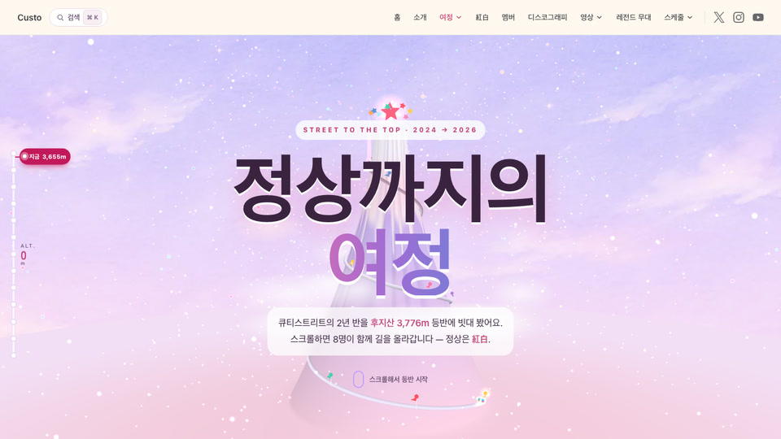
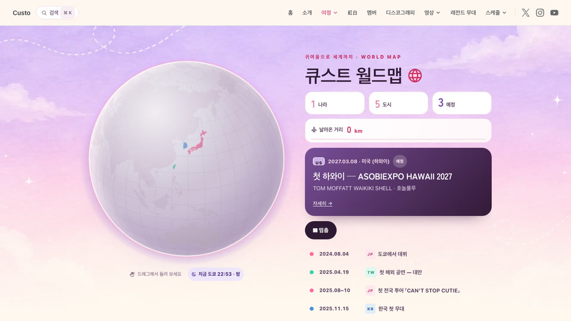

[한국어](README.md) · English

 

## What I'm building now

### vibing

  

Snap a photo of what you eat and a turtle coach named **Bibi** logs the calories and protein. Bibi also plans the day's gym session. It sets the weights from your sex, muscle mass and a photo of your InBody sheet, tells you the next set while you rest, and remembers the exercises you'd rather skip. You and your friends see each other's meals. It's my eleventh weight-loss or fitness app, and the first one to reach a store.

  
  
  

  

<a href="https://apps.apple.com/kr/app/id6815520523">On the App Store</a> since October 2026 · Google Play in closed testing · Next.js · Supabase · Capacitor · records on screen are from a test account

 

### AI game battles

I ask an AI for a game in a few lines, play what it builds, and post the result on YouTube. Twice I gave two AIs the same one-line prompt and let them compete, and once the winner got an extra day. Lately I play the one-line first draft, tell the AI what felt off, and have it rebuild the same game a few times. The code is published exactly as the AI wrote it. Click a picture and it runs in the browser. The games are in Korean.

  
  
  
  
  
  

November 2026 · no-build HTML · PC keyboard and mouse · <a href="https://wonjangcloud9.github.io/ai-game-battle/">see all of them, including the ones GPT-6 made</a> · <a href="https://github.com/wonjangcloud9/ai-game-battle">code</a>

 

### Custo

  

An unofficial fan site for Korean fans of the Japanese idol group CUTIE STREET. It gathers the members, videos, schedule, discography and TV appearances in one place, and every six hours it rechecks the official news and schedule and updates itself. There's also a 3D story that tells the road from debut to NHK's Kohaku as a climb up Mount Fuji, and a globe that fills in each place the group has performed. It started in April as a site for learning Japanese, and I rebuilt it as a fan site in November. The site is in Korean.

  
  

November 2026 · VitePress · Vue 3 · three.js · d3 · about 550 videos · member photos only as official embeds · <a href="https://github.com/wonjangcloud9/custo">code</a>

 

## nanika · 100 services

The plan was one small web service a day, each posted as an Instagram Reel, until I reached 100. I made eight in four days and closed shop. They're all still up, so click one and try it.

  
  
  
  
  
  
  
  
  

The one I spent longest on is #006, the museum. I built a three-story hall and ten galleries in three.js and hung all 369 of Korea's National Treasures in them. The services are in Korean.

September 2026 · one HTML file each, no build step · three.js · GitHub Pages

 

<b>Six open-source tools</b>

 

- **[notdone](https://github.com/wonjangcloud9/notdone)** A Claude Code skill that asks for evidence when an agent says "done" without ever looking at the screen
- **[wj-mods](https://github.com/wonjangcloud9/wj-mods)** Claude Code mods that put per-session progress, usage, long-turn alerts and session nicknames in the terminal
- **[claude-tree](https://github.com/wonjangcloud9/claude-tree)** Runs several Claude Code sessions in parallel, each in its own git worktree
- **[open-guardrail](https://github.com/wonjangcloud9/open-guardrail)** Guardrails for LLM apps. Zero API calls, under 0.1ms
- **[wonjangAgent](https://github.com/wonjangcloud9/wonjangAgent)** A Korean-first autonomous AI agent. Single Rust binary
- **[harness-eval](https://github.com/wonjangcloud9/harness-eval)** A CLI that puts a number on how much the harness changes results

 

## The path so far

<picture>
  <source media="(prefers-color-scheme: dark)" srcset="./assets/dashboard-dark-afbc674b58.svg">
  
</picture>

<!-- contributions:start -->

<b>Every pull request and issue I sent to other projects</b>

 

Problems I hit while using a tool, fixed or reported. Many only show up when you work in Korean, such as IME input and Korean captions. 95 pull requests and 15 issues across 46 projects, 31 merged so far.

| Project | What it is | Mine |
|---|---|---|
| **[hyperframes](https://github.com/heygen-com/hyperframes)** ★ 90k | Framework that renders HTML, CSS and GSAP to video frame by frame in headless Chrome, with a CLI linter and checker (TypeScript) | PR&nbsp;35 16&nbsp;merged 8&nbsp;issues |
| **[ant-design](https://github.com/ant-design/ant-design)** ★ 100k | Ant Design, the enterprise React UI library (TypeScript) | PR&nbsp;2 2&nbsp;merged |
| **[faker](https://github.com/faker-js/faker)** ★ 16k | Generates fake test data such as names, addresses and phone numbers, per locale (TypeScript) | PR&nbsp;2 2&nbsp;merged |
| **[mui-x](https://github.com/mui/mui-x)** ★ 5.9k | MUI's advanced React components (Data Grid, Date Pickers, Charts) | PR&nbsp;3 1&nbsp;merged |
| **[holidays](https://github.com/spatie/holidays)** ★ 411 | PHP library that calculates public holidays per country | PR&nbsp;3 1&nbsp;merged |
| **[business-day](https://github.com/kylekatarnls/business-day)** ★ 405 | PHP extension that adds business-day and holiday calculations to the Carbon date library | PR&nbsp;2 1&nbsp;merged |

<b>40 more projects</b>

 

| Project | What it is | Mine |
|---|---|---|
| **[three.js](https://github.com/mrdoob/three.js)** ★ 119k | three.js, the 3D graphics library for the web, and its editor (JavaScript) | PR&nbsp;1 1&nbsp;merged |
| **[ragflow](https://github.com/infiniflow/ragflow)** ★ 95k | RAG engine that answers from your documents with citations, grown into context infrastructure for agents (Go, TypeScript) | PR&nbsp;1 1&nbsp;merged |
| **[memos](https://github.com/usememos/memos)** ★ 65k | Open-source self-hosted note-taking app that collects your thoughts in a personal timeline (Go) | PR&nbsp;1 1&nbsp;merged |
| **[filament](https://github.com/filamentphp/filament)** ★ 33k | Framework for building admin panels and business apps with Laravel (PHP) | PR&nbsp;1 1&nbsp;merged |
| **[element-plus](https://github.com/element-plus/element-plus)** ★ 28k | UI component library for Vue 3 (TypeScript) | PR&nbsp;1 1&nbsp;merged |
| **[thinkrail](https://github.com/JetBrains/thinkrail)** ★ 8.4k | JetBrains' desktop and web IDE for AI coding agents (TypeScript) | PR&nbsp;1 1&nbsp;merged |
| **[countries](https://github.com/mledoze/countries)** ★ 6.3k | World countries data (names, capitals, currencies, translations) in JSON, CSV, XML and YAML | PR&nbsp;1 1&nbsp;merged |
| **[squire](https://github.com/squirephp/squire)** ★ 1.1k | Laravel package with reference data such as countries, regions and currencies (PHP) | PR&nbsp;1 1&nbsp;merged |
| **[vscode](https://github.com/microsoft/vscode)** ★ 196k | Microsoft's code editor VS Code (TypeScript) | PR&nbsp;5 1&nbsp;issue |
| **[hermes-agent](https://github.com/NousResearch/hermes-agent)** ★ 266k | Autonomous AI agent for the terminal, desktop and chat apps, with a dashboard and an agent-to-agent server (Python) | PR&nbsp;5 |
| **[validator.js](https://github.com/validatorjs/validator.js)** ★ 24k | String validation library: emails, passport numbers and so on (JavaScript) | PR&nbsp;2 |
| **[cloudflare-os](https://github.com/cloudflare/cloudflare-os)** ★ 12k | Agent workspace built on Cloudflare Workers (TypeScript) | PR&nbsp;2 |
| **[Ant-Media-Server](https://github.com/ant-media/Ant-Media-Server)** ★ 4.7k | Streaming server with ~0.5 s latency over WebRTC (Java) | 2&nbsp;issues |
| **[countries](https://github.com/countries/countries)** ★ 2.4k | Ruby library with ISO country data: codes, currencies and phone number rules (Ruby) | PR&nbsp;2 |
| **[awesome-claude-plugins](https://github.com/composio-community/awesome-claude-plugins)** ★ 2.0k | Curated list of Claude Code plugins | PR&nbsp;2 |
| **[bloom](https://github.com/safety-research/bloom)** ★ 1.4k | Pipeline that automatically evaluates how often an LLM shows a given behaviour (Python) | 2&nbsp;issues |
| **[hoppscotch](https://github.com/hoppscotch/hoppscotch)** ★ 81k | Open-source API client, a Postman alternative (TypeScript) | PR&nbsp;1 |
| **[strapi](https://github.com/strapi/strapi)** ★ 74k | Open-source headless CMS (TypeScript) | PR&nbsp;1 |
| **[Ghost](https://github.com/TryGhost/Ghost)** ★ 56k | Ghost, the publishing platform with newsletters and memberships (JavaScript) | PR&nbsp;1 |
| **[expo](https://github.com/expo/expo)** ★ 54k | Framework and build service for Android, iOS and web apps in React | 1&nbsp;issue |
| **[date-fns](https://github.com/date-fns/date-fns)** ★ 37k | Date utility library: arithmetic, formatting and parsing, with locales (TypeScript) | PR&nbsp;1 |
| **[plyr](https://github.com/sampotts/plyr)** ★ 30k | HTML5, YouTube and Vimeo media player (JavaScript) | 1&nbsp;issue |
| **[xterm.js](https://github.com/xtermjs/xterm.js)** ★ 21k | Web terminal library behind the terminals in VS Code, Cursor and other apps (TypeScript) | PR&nbsp;1 |
| **[sveltejs/kit](https://github.com/sveltejs/kit)** ★ 21k | Svelte's full-stack web framework: routing, SSR, redirects | PR&nbsp;1 |
| **[Fuse](https://github.com/krisk/Fuse)** ★ 21k | Lightweight fuzzy-search library (JavaScript) | PR&nbsp;1 |
| **[faker](https://github.com/joke2k/faker)** ★ 20k | Python library that generates fake test data such as names, addresses and phone numbers, per locale | PR&nbsp;1 |
| **[naive-ui](https://github.com/tusen-ai/naive-ui)** ★ 19k | Vue 3 UI component library (TypeScript) | PR&nbsp;1 |
| **[learnharness](https://github.com/amosblomqvist/learnharness)** ★ 12k | Agent harness for learning difficult things (TypeScript) | PR&nbsp;1 |
| **[es-toolkit](https://github.com/toss/es-toolkit)** ★ 11k | Toss's small, fast utility library that replaces lodash (TypeScript) | PR&nbsp;1 |
| **[semi-design](https://github.com/DouyinFE/semi-design)** ★ 10k | React UI design system from the Douyin (TikTok) team (TypeScript) | PR&nbsp;1 |
| **[mimesis](https://github.com/lk-geimfari/mimesis)** ★ 4.9k | Python library that generates fake test data in many locales | PR&nbsp;1 |
| **[Spoolman](https://github.com/Donkie/Spoolman)** ★ 3.1k | Self-hosted inventory tracker for 3D-printer filament spools (Python) | PR&nbsp;1 |
| **[javascript](https://github.com/clerk/javascript)** ★ 1.8k | JavaScript SDKs and UI for Clerk, the auth and user-management service (TypeScript) | PR&nbsp;1 |
| **[Nager.Date](https://github.com/nager/Nager.Date)** ★ 1.4k | Public holidays for 200+ countries as a .NET library and REST API (C#) | PR&nbsp;1 |
| **[citty](https://github.com/unjs/citty)** ★ 1.4k | Lightweight CLI builder from unjs (Nuxt ecosystem): argument parsing and usage text (TypeScript) | PR&nbsp;1 |
| **[date-holidays](https://github.com/commenthol/date-holidays)** ★ 1.1k | Library that computes public holidays by country and region, including lunar festivals and substitute-holiday rules (JavaScript) | PR&nbsp;1 |
| **[phone](https://github.com/AfterShip/phone)** ★ 922 | Validates mobile phone numbers and normalizes them to E.164 (TypeScript) | PR&nbsp;1 |
| **[DateTimeExtensions](https://github.com/joaomatossilva/DateTimeExtensions)** ★ 902 | .NET library for per-country holidays and working days (C#) | PR&nbsp;1 |
| **[python-stdnum](https://github.com/arthurdejong/python-stdnum)** ★ 610 | Python library that validates hundreds of national and international number formats such as tax IDs, IBANs and ID numbers | PR&nbsp;1 |
| **[definitions](https://github.com/holidays/definitions)** ★ 118 | Per-country public holiday definitions in YAML, the data behind the Ruby holidays gem | PR&nbsp;1 |

**Recently merged**

- [ant-design #59982](https://github.com/ant-design/ant-design/pull/59982) fix(locale): fix word order and particles in ko_KR form validation messages
- [thinkrail #1475](https://github.com/JetBrains/thinkrail/pull/1475) feat(locales): add a Korean translation
- [three.js #35694](https://github.com/mrdoob/three.js/pull/35694) Editor: Translate the remaining English strings in Korean.
- [squire #132](https://github.com/squirephp/squire/pull/132) Update South Korean regions: rename KR-42 Gangwon, add KR-50 Sejong
- [ant-design #59978](https://github.com/ant-design/ant-design/pull/59978) fix(locale): add missing ko_KR clear and OTP cell labels

<b>26 earlier merged pull requests</b>

 

- [ragflow #22696](https://github.com/infiniflow/ragflow/pull/22696) i18n(ko): fill in missing Korean translations and sync ko.ts with en.ts
- [filament #21085](https://github.com/filamentphp/filament/pull/21085) Add missing Korean translations
- [memos #6616](https://github.com/usememos/memos/pull/6616) chore(i18n): translate the remaining English strings in Korean
- [mui-x #24295](https://github.com/mui/mui-x/pull/24295) [l10n] Improve Korean (ko-KR) locale
- [element-plus #25109](https://github.com/element-plus/element-plus/pull/25109) fix(locale): [ko] translate missing strings
- [business-day #165](https://github.com/kylekatarnls/business-day/pull/165) Add Korean substitute holidays, Labor Day and Constitution Day
- [faker #4279](https://github.com/faker-js/faker/pull/4279) fix(locale): replace Gwangju and South Jeolla with the Jeonnam-Gwangju special city for ko
- [hyperframes #8261](https://github.com/heygen-com/hyperframes/pull/8261) docs(skills): give the 9:16 safe band that `check` enforces
- [countries #613](https://github.com/mledoze/countries/pull/613) Fix Korean translations copied from other countries (IO, DM, GS) and update TR, MN, SO
- [holidays #359](https://github.com/spatie/holidays/pull/359) Fix Korea's Christmas date (December 25, not 15)
- [hyperframes #8084](https://github.com/heygen-com/hyperframes/pull/8084) fix(check): a number with a separator counts as one word in line reading time
- [hyperframes #8083](https://github.com/heygen-com/hyperframes/pull/8083) fix(cli): a render that failed on a video file says to check the file, not to try Docker
- [hyperframes #7954](https://github.com/heygen-com/hyperframes/pull/7954) fix(check): a media source that failed to load is not reported as a timeout
- [hyperframes #7953](https://github.com/heygen-com/hyperframes/pull/7953) fix(cli): help shows each option's default once
- [faker #4276](https://github.com/faker-js/faker/pull/4276) fix(locale): use five-digit postcodes with assigned prefixes for ko
- [hyperframes #7842](https://github.com/heygen-com/hyperframes/pull/7842) fix(cli): render --json gives each missing tool, a held slot and an old Node its own code
- [hyperframes #7816](https://github.com/heygen-com/hyperframes/pull/7816) fix(ci): a catalog publish run that main overtook ends clean instead of failing
- [hyperframes #7805](https://github.com/heygen-com/hyperframes/pull/7805) fix(sdk-playground): the Vite config loads on Node 22 before 22.18
- [hyperframes #7804](https://github.com/heygen-com/hyperframes/pull/7804) fix(registry): caption keywords, emoji and aftershock work for words outside a-z
- [hyperframes #7803](https://github.com/heygen-com/hyperframes/pull/7803) fix(engine): a failed parallel capture names the worker that failed, not the peers it stopped
- [hyperframes #7752](https://github.com/heygen-com/hyperframes/pull/7752) fix(check): mark a contrast finding by its severity and quote its text
- [hyperframes #7700](https://github.com/heygen-com/hyperframes/pull/7700) fix(lint): say the audio overlap warning is about a shared Studio lane
- [hyperframes #7699](https://github.com/heygen-com/hyperframes/pull/7699) fix(check): name a color-graded video by its own selector in layout findings
- [hyperframes #7697](https://github.com/heygen-com/hyperframes/pull/7697) fix(cli): the render header names the quality preset and CRF it encodes with
- [hyperframes #7689](https://github.com/heygen-com/hyperframes/pull/7689) fix(cli): stop the CLI build looking for the removed gsap skill
- [hyperframes #7608](https://github.com/heygen-com/hyperframes/pull/7608) fix(cli): quote the project name in init's printed `cd` commands

<b>60 pull requests in review</b>

 

- [cloudflare-os #1289](https://github.com/cloudflare/cloudflare-os/pull/1289) Context: don't commit a name on an IME composition Enter
- [vscode #350153](https://github.com/microsoft/vscode/pull/350153) Screenshot annotation: leave Escape and Enter to an IME that is still composing
- [vscode #350151](https://github.com/microsoft/vscode/pull/350151) Editor: measure the fullwidth character width with a CJK ideograph
- [vscode #350145](https://github.com/microsoft/vscode/pull/350145) Terminal: keep CJK sentence and list punctuation out of local file links
- [vscode #350141](https://github.com/microsoft/vscode/pull/350141) Quick pick: match the Hangul syllable an IME is still composing
- [vscode #350140](https://github.com/microsoft/vscode/pull/350140) Fix terminal IME composition rendering below the cursor in Modern UI
- [javascript #10976](https://github.com/clerk/javascript/pull/10976) chore(localizations): Fill in the missing Korean (ko-KR) translations
- [naive-ui #8270](https://github.com/tusen-ai/naive-ui/pull/8270) fix(locale): translate weekPlaceholder in the Korean locale
- [semi-design #4117](https://github.com/DouyinFE/semi-design/pull/4117) fix(locale): add missing Korean Upload crop text and fix wrong ko_KR strings
- [hyperframes #8701](https://github.com/heygen-com/hyperframes/pull/8701) fix(producer): a local span render skips the Lambda plan cap
- [hoppscotch #6829](https://github.com/hoppscotch/hoppscotch/pull/6829) chore(common): complete Korean (ko) translations
- [DateTimeExtensions #290](https://github.com/joaomatossilva/DateTimeExtensions/pull/290) Fix ko-KR substitute holidays (Chuseok 2028 hang) and add Jeheonjeol
- [Ghost #33258](https://github.com/TryGhost/Ghost/pull/33258) 🌐 Filled empty Korean (ko) translations
- [strapi #28771](https://github.com/strapi/strapi/pull/28771) chore(translations): complete Korean (ko) admin translations
- [Nager.Date #1215](https://github.com/nager/Nager.Date/pull/1215) South Korea: add the substitute holiday for Christmas from 2023
- [countries #977](https://github.com/countries/countries/pull/977) Update South Korean subdivisions: Gangwon (KR-42), Jeonbuk (KR-45), Sejong (KR-50)
- [countries #976](https://github.com/countries/countries/pull/976) Allow 10-digit national numbers for South Korea (KR)
- [mui-x #24308](https://github.com/mui/mui-x/pull/24308) [l10n][charts] Add Korean (ko-KR) locale
- [Spoolman #1339](https://github.com/Donkie/Spoolman/pull/1339) Keep the label sort toggle on one line in CJK and Thai
- [mui-x #24303](https://github.com/mui/mui-x/pull/24303) [l10n][scheduler] Improve Korean (ko-KR) locale
- [mimesis #1768](https://github.com/lk-geimfari/mimesis/pull/1768) fix(ko): use the current names of South Korea's first-level regions
- [business-day #166](https://github.com/kylekatarnls/business-day/pull/166) Use the Korean lunar calendar for Korean lunar holidays
- [phone #470](https://github.com/AfterShip/phone/pull/470) Update South Korea to 010-only mobile numbers
- [holidays #361](https://github.com/spatie/holidays/pull/361) Use the Korean lunar calendar for Korea's lunar holidays
- [holidays #360](https://github.com/spatie/holidays/pull/360) Add Korea's substitute holidays and the 2026 Labour Day and Constitution Day
- [validator.js #2963](https://github.com/validatorjs/validator.js/pull/2963) fix(isMobilePhone): reject pipes in ko-KR numbers
- [definitions #412](https://github.com/holidays/definitions/pull/412) Add kr Labour Day and make Constitution Day a holiday from 2026
- [faker #2544](https://github.com/joke2k/faker/pull/2544) Generate ko_KR postcodes with assigned prefixes only
- [citty #300](https://github.com/unjs/citty/pull/300) fix(usage): render aliases longer than one character with two dashes
- [python-stdnum #530](https://github.com/arthurdejong/python-stdnum/pull/530) Accept South Korean RRNs given out since October 2020
- [xterm.js #6330](https://github.com/xtermjs/xterm.js/pull/6330) Send a committed IME composition before the custom key handler sees the key
- [date-holidays #728](https://github.com/commenthol/date-holidays/pull/728) fix(KR): add Labour Day as a public holiday from 2026
- [awesome-claude-plugins #765](https://github.com/composio-community/awesome-claude-plugins/pull/765) Add brainres to Developer Productivity
- [date-fns #4463](https://github.com/date-fns/date-fns/pull/4463) Fix ko locale long and full time formats pairing 오전/오후 with a 24-hour hour
- [validator.js #2962](https://github.com/validatorjs/validator.js/pull/2962) fix(isPassportNumber): accept South Korea's next-generation passport numbers
- [hyperframes #7705](https://github.com/heygen-com/hyperframes/pull/7705) fix(check): a nested line's words stay out of the line around it
- [hyperframes #7703](https://github.com/heygen-com/hyperframes/pull/7703) fix(check): line_unread names the captions track that exempts a caption
- [hyperframes #7701](https://github.com/heygen-com/hyperframes/pull/7701) fix(lint): keep separate count-up objects apart in the repeated fromTo check
- [hyperframes #7698](https://github.com/heygen-com/hyperframes/pull/7698) fix(check): keep the outline a word inherits from its caption in contrast
- [hyperframes #7696](https://github.com/heygen-com/hyperframes/pull/7696) fix(lint): warn when a video's slot outlasts its source
- [hyperframes #7695](https://github.com/heygen-com/hyperframes/pull/7695) fix(cli): a low-disk render refusal names the extracted-frame cache and clean
- [hyperframes #7694](https://github.com/heygen-com/hyperframes/pull/7694) docs: credit the OpenStreetMap and CARTO sources of the korea-map block asset
- [hyperframes #7693](https://github.com/heygen-com/hyperframes/pull/7693) docs(skills): say a variable must be declared before data-var-* binds it
- [hyperframes #7692](https://github.com/heygen-com/hyperframes/pull/7692) docs(skills): say a later fromTo needs immediateRender: false
- [hyperframes #7691](https://github.com/heygen-com/hyperframes/pull/7691) fix(cli): say init's skills install is global and how to skip it
- [hyperframes #7690](https://github.com/heygen-com/hyperframes/pull/7690) fix(registry): caption components group a replaced transcript instead of crashing
- [hyperframes #7688](https://github.com/heygen-com/hyperframes/pull/7688) fix(cli): doctor stops reporting a failure when only optional checks are missing
- [learnharness #698](https://github.com/amosblomqvist/learnharness/pull/698) fix: leave Enter and Escape to an IME composition in rename and folder fields
- [hermes-agent #153803](https://github.com/NousResearch/hermes-agent/pull/153803) fix(desktop): leave Enter and Escape to an IME composition in log and page search
- [hyperframes #7564](https://github.com/heygen-com/hyperframes/pull/7564) fix(cli): size exported caption cues by display width, so CJK cues fit like Latin ones
- [hermes-agent #153677](https://github.com/NousResearch/hermes-agent/pull/153677) fix(bot-mode): print a teammate's reply as text, not \uXXXX escapes
- [hyperframes #7559](https://github.com/heygen-com/hyperframes/pull/7559) fix(cli): refuse SRT and VTT files that are not UTF-8 instead of importing mojibake
- [hyperframes #7558](https://github.com/heygen-com/hyperframes/pull/7558) fix(registry): split typed and falling text by grapheme, not UTF-16 unit
- [sveltejs/kit #17717](https://github.com/sveltejs/kit/pull/17717) fix: percent-encode non-ASCII characters in redirect locations
- [hermes-agent #152042](https://github.com/NousResearch/hermes-agent/pull/152042) fix(kanban): leave Enter and Escape to an in-flight IME composition
- [hermes-agent #152023](https://github.com/NousResearch/hermes-agent/pull/152023) fix(dashboard): leave Enter and Escape to an in-flight IME composition
- [es-toolkit #2209](https://github.com/toss/es-toolkit/pull/2209) fix[compat/truncate]: count emoji sequences as one character like Lodash
- [hyperframes #7449](https://github.com/heygen-com/hyperframes/pull/7449) fix(studio): leave Enter and Escape to an IME that is still composing
- [hyperframes #7409](https://github.com/heygen-com/hyperframes/pull/7409) feat(check): warn when a line break cuts a Korean word in two
- [awesome-claude-plugins #571](https://github.com/composio-community/awesome-claude-plugins/pull/571) Add wj-mods to Developer Productivity

<b>15 issues reported</b>

 

- [vscode #350152](https://github.com/microsoft/vscode/issues/350152) Screenshot annotation: Escape during an IME composition discards the text being typed
- [hyperframes #7753](https://github.com/heygen-com/hyperframes/issues/7753) check: a contrast finding on an id-less element is named from <body>, past ancestors that have an id
- [hyperframes #7713](https://github.com/heygen-com/hyperframes/issues/7713) Render progress bar sits at 77% when 95% of a long streaming render is done
- [hyperframes #7712](https://github.com/heygen-com/hyperframes/issues/7712) check: container_overflow "Nowrap text is wider than its container" fires for absolutely positioned titles in an unsized wrapper
- [hyperframes #7711](https://github.com/heygen-com/hyperframes/issues/7711) check: text hidden under an opaque cover is reported twice, as text_occluded and as a contrast failure against the cover
- [hyperframes #7710](https://github.com/heygen-com/hyperframes/issues/7710) check: text_below_floor repeats one style's finding once per scene file (74 warnings for one 27 px label class)
- [hyperframes #7709](https://github.com/heygen-com/hyperframes/issues/7709) check: line_unread reports every text chunk of a closing card as "the film's last line"
- [hyperframes #7707](https://github.com/heygen-com/hyperframes/issues/7707) New-project AGENTS.md tells agents to run `npm run check`, which the check docs say never to do
- [hyperframes #7706](https://github.com/heygen-com/hyperframes/issues/7706) check: a media-metadata rebind rewinds scene timelines to 0 between a seek and its read, so findings change between identical runs
- [bloom #28](https://github.com/safety-research/bloom/issues/28) Noisy LiteLLM debug messages pollute output
- [bloom #27](https://github.com/safety-research/bloom/issues/27) Pipeline hangs silently when API keys are missing
- [expo #25561](https://github.com/expo/expo/issues/25561) Apk made with EAS, expo 49 version of easy does not allow api calls
- [Ant-Media-Server #4267](https://github.com/ant-media/Ant-Media-Server/issues/4267) Self-camera switching
- [plyr #2434](https://github.com/sampotts/plyr/issues/2434) mobile player Error
- [Ant-Media-Server #3989](https://github.com/ant-media/Ant-Media-Server/issues/3989) A phenomenon in which the microphone and speaker function of Bluetooth earphones go to a mobile phone when connecting webrtc with Javascript using peer.html while using Bluetooth earphones.

<b>4 closed pull requests</b>

 

- [cloudflare-os #1279](https://github.com/cloudflare/cloudflare-os/pull/1279) Context: don't commit a name on an IME composition Enter
- [hyperframes #7704](https://github.com/heygen-com/hyperframes/pull/7704) fix(check): time a line the next scene repeats in place as one line
- [Fuse #861](https://github.com/krisk/Fuse/pull/861) fix(diacritics): compose Hangul back after stripping, so Korean search keeps working
- [hermes-agent #152043](https://github.com/NousResearch/hermes-agent/pull/152043) fix(a2a): reject a non-ASCII bearer token with 401 instead of crashing

<!-- contributions:end -->

 

<table>
<tr><td width="92" align="center"><b>2019</b> 2 repos</td><td>
First commit. I started by cloning KakaoTalk and Netflix.
</td></tr>
<tr><td align="center"><b>2020–21</b> 385 commits</td><td>
The years I didn't use GitHub. I didn't know it mattered, so the code stayed on my laptop. <b>Zero commits in 2020.</b>
</td></tr>
<tr><td align="center"><b>2022</b> 91 repos 1,160 commits</td><td>
React, Next.js and Django. I cloned Karrot Market, Airbnb and Twitter, eight repos a month.
</td></tr>
<tr><td align="center"><b>2023</b> 116 repos 1,894 commits</td><td>
<b>My busiest year for repos.</b> Flutter, React Native and Jetpack Compose at once, plus my first real product attempts: a toilet finder, an education LMS, a complaint tracker and an AI companion.
</td></tr>
<tr><td align="center"><b>2024</b> 48 repos 1,314 commits</td><td>
LangChain and RAG put an LLM in a product for the first time.
</td></tr>
<tr><td align="center"><b>2025</b> 45 repos 852 commits</td><td>
Five health apps. Late in the year I stopped using other people's agents and <b>started writing my own</b>.
</td></tr>
<tr><td align="center"><b>2026</b> 48 repos 4,970 commits</td><td>
Shipped agent tools to npm and PyPI. In September I opened eight web services in four days with nanika; in October vibing went out on the App Store. In November I had AI build games and opened ten of them, and rebuilt Custo as a CUTIE STREET fan site. <b>My highest-commit year, and it's only November.</b>
</td></tr>
</table>

## Subjects I kept coming back to

<b>How many repos each, and how far they got</b>

 

| Subject | Repos | How far it got |
|---|---|---|
| 🤖 **Agents & LLMs** | 26 | Following courses → writing my own → **four packages on npm and PyPI** |
| 🏃 **Weight & fitness** | 11 | The eleventh, vibing, is the first to reach the App Store. The first ten taught me what to cut |
| 🎌 **Fandom & Japanese** | 7 | Consolidated into [Custo](https://custo-kr.vercel.app/), now a CUTIE STREET fan site |
| ⏱️ **Pomodoro** | 6 | One per new framework I picked up |
| 🎵 **TikTok clones** | 3 | Where I actually learned Flutter animations |
| 😴 **Sleep** | 3 | [Jammanbo](https://life-save-with-claude-code-multi-se.vercel.app) is the one that stuck |

I tend to stay on one subject for a long time.

## Tools

TypeScript · Next.js · React · Capacitor · Python · Rust · Flutter · Supabase · PostgreSQL · three.js · Claude Code

 

<picture>
  <source media="(prefers-color-scheme: dark)" srcset="https://raw.githubusercontent.com/wonjangcloud9/wonjangcloud9/output/snake-dark.svg">
  
</picture>

196 of my 358 repos are private because they hold keys or personal data. The numbers above include private commits.

