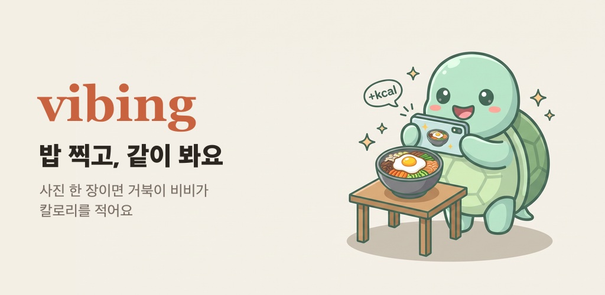
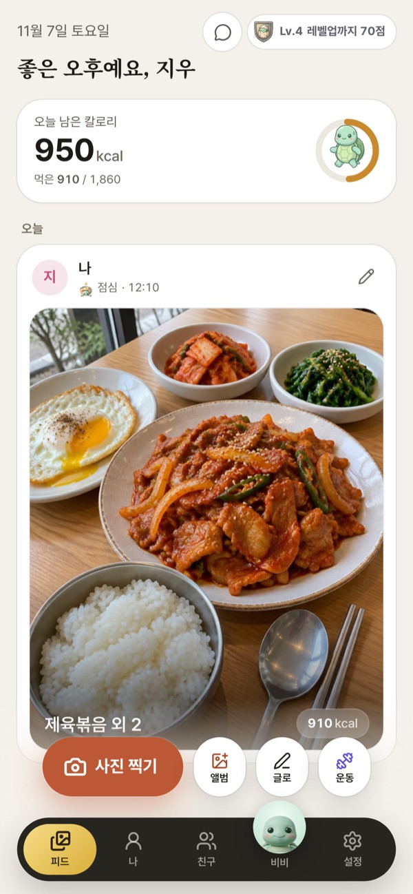
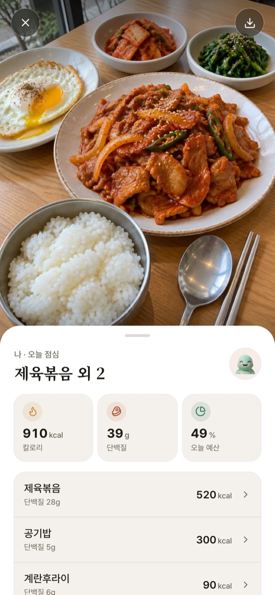
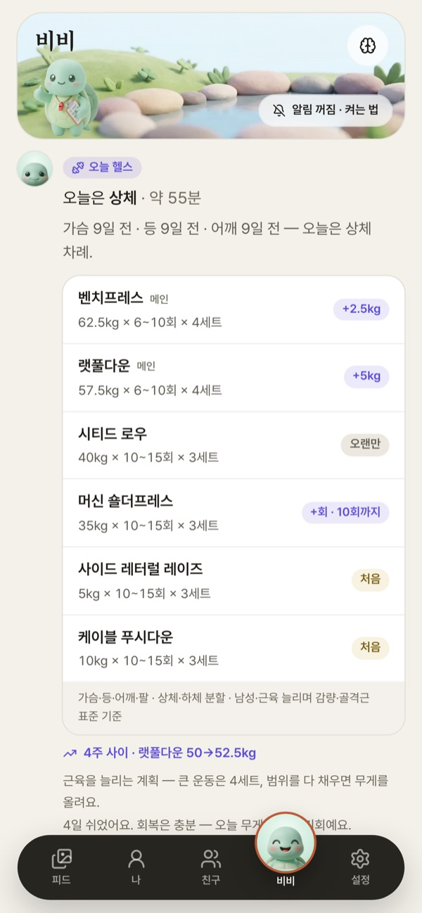
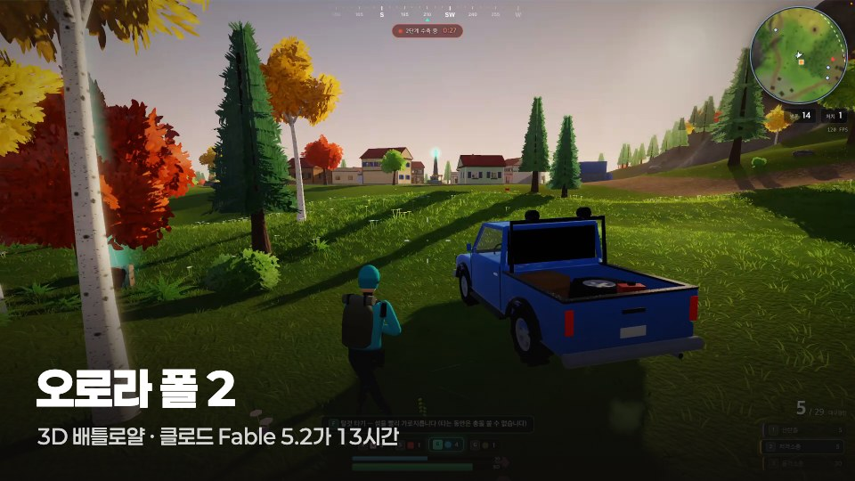
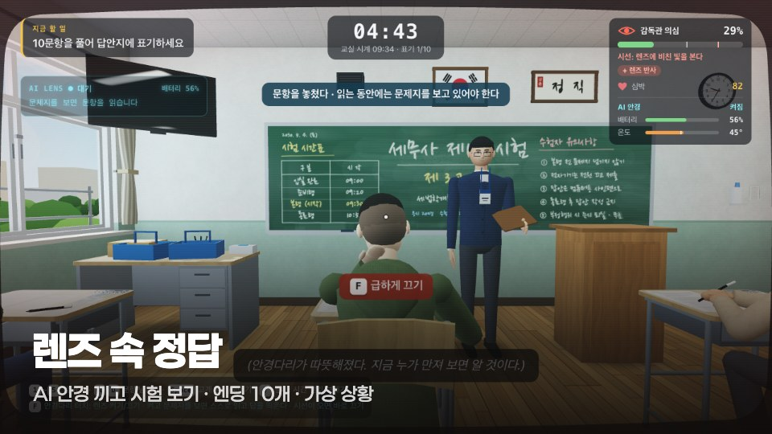
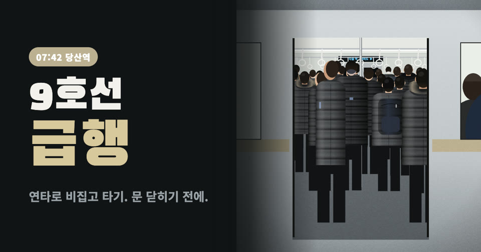
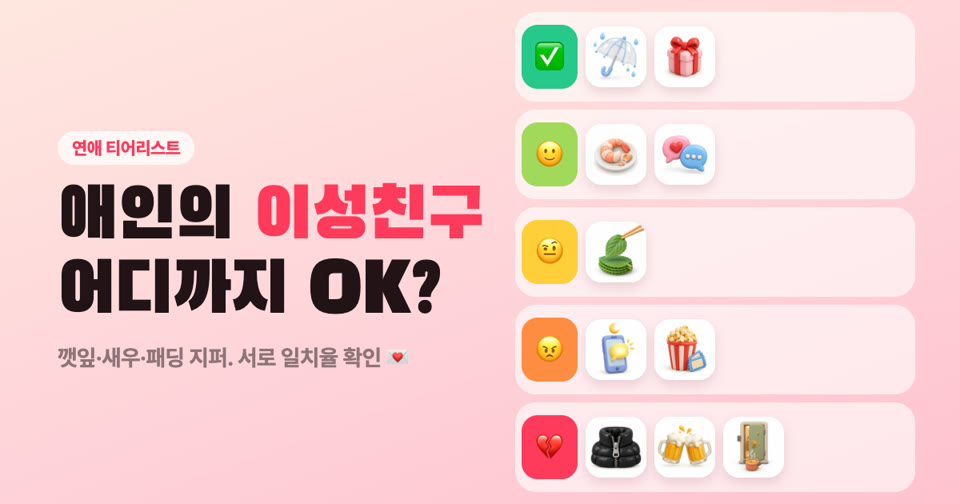

한국어 · [English](README.en.md)

 

## 지금 만드는 것

### vibing

  

먹은 걸 사진 한 장으로 남기면 거북이 코치 **비비**가 칼로리와 단백질을 적어 주는 감량 앱입니다. 비비는 그날 헬스도 짜 줍니다. 성별, 근육량, 인바디 사진을 보고 무게를 정하고, 쉬는 동안 다음 세트를 알려 주고, 하기 싫다는 운동은 기억했다가 뺍니다. 친구와는 서로의 끼니를 같이 봅니다. 감량·운동 앱으로는 열한 번째이고, 스토어까지 간 건 처음입니다.

  
  
  

  

2026년 10월 <a href="https://apps.apple.com/kr/app/id6815520523">앱스토어 출시</a> · 구글 플레이는 비공개 테스트 중 · Next.js · Supabase · Capacitor · 화면 속 기록은 테스트 계정

 

### AI 게임 대결

AI에게 몇 줄로 부탁해서 게임을 만들게 하고, 제가 직접 해 본 뒤 유튜브에 올립니다. 같은 한 줄을 두 AI에게 줘서 겨루게 한 적도 있고, 이긴 쪽에 하루를 더 준 적도 있습니다. 코드는 AI가 쓴 그대로 올려 뒀습니다. 그림을 누르면 브라우저에서 바로 됩니다.

  
  
  
  

2026년 11월 · 빌드 없는 HTML · PC 키보드와 마우스 · <a href="https://wonjangcloud9.github.io/ai-game-battle/">GPT-6가 만든 쪽까지 전부 보기</a> · <a href="https://github.com/wonjangcloud9/ai-game-battle">코드</a>

 

## nanika · 서비스 100개 만들기

하루에 하나씩 작은 웹 서비스를 만들어 인스타그램 릴스로 올리던 프로젝트입니다. 목표는 100개였고, 나흘 동안 여덟 개를 만든 뒤 문을 닫았습니다. 만든 건 전부 그대로 열어 두었으니 눌러서 해 보세요.

  
  
  
  
  
  
  
  
  

가장 오래 붙든 건 #006 국보 박물관입니다. three.js로 3층 높이 홀과 전시실 열 곳을 짓고 국보 369점을 전부 걸었습니다.

2026년 9월 · 빌드 없는 HTML 한 장씩 · three.js · GitHub Pages

 

<b>오픈소스로 풀어 둔 도구 6개</b>

 

- **[notdone](https://github.com/wonjangcloud9/notdone)** 에이전트가 화면을 보지도 않고 "다 했어요"라고 할 때 증거를 요구하는 Claude Code 스킬
- **[wj-mods](https://github.com/wonjangcloud9/wj-mods)** 세션별 진행 상황, 사용량, 긴 작업 알림, 세션 별명을 터미널에 붙이는 Claude Code 모드 모음
- **[claude-tree](https://github.com/wonjangcloud9/claude-tree)** Claude Code 세션을 git worktree로 나눠 여러 개 동시에 굴리는 CLI
- **[open-guardrail](https://github.com/wonjangcloud9/open-guardrail)** LLM 앱용 가드레일. API 호출 없이 0.1ms 안에
- **[wonjangAgent](https://github.com/wonjangcloud9/wonjangAgent)** 한국어 우선 자율 AI 에이전트. Rust 단일 바이너리
- **[harness-eval](https://github.com/wonjangcloud9/harness-eval)** 하네스가 결과를 얼마나 바꾸는지 숫자로 보는 CLI

 

## 지나온 길

<picture>
  <source media="(prefers-color-scheme: dark)" srcset="./assets/dashboard-dark-98a7590bc5.svg">
  
</picture>

 

<table>
<tr><td width="92" align="center"><b>2019</b> 레포 2</td><td>
첫 커밋. 코코아톡과 넷플릭스를 따라 만들면서 시작했습니다.
</td></tr>
<tr><td align="center"><b>2020–21</b> 커밋 385</td><td>
깃허브를 쓰지 않던 시기. 중요한 줄 몰라서 코드가 로컬에만 쌓였습니다. 2020년 커밋 <b>0개</b>.
</td></tr>
<tr><td align="center"><b>2022</b> 레포 91 커밋 1,160</td><td>
React·Next.js·Django. 당근마켓, 에어비앤비, 트위터를 클론하며 한 달에 8개씩 레포를 열었습니다.
</td></tr>
<tr><td align="center"><b>2023</b> 레포 116 커밋 1,894</td><td>
<b>역대 최다 레포.</b> Flutter·React Native·Jetpack Compose를 동시에 다뤘고, 처음으로 제품을 시도했습니다. 화장실 찾기, 교육 LMS, 민원 처리, AI 컴패니언이었습니다.
</td></tr>
<tr><td align="center"><b>2024</b> 레포 48 커밋 1,314</td><td>
LangChain·RAG로 LLM을 처음 제품에 붙였습니다.
</td></tr>
<tr><td align="center"><b>2025</b> 레포 45 커밋 852</td><td>
건강·운동 앱을 다섯 개 만들었습니다. 후반엔 에이전트를 직접 짜기 시작했습니다.
</td></tr>
<tr><td align="center"><b>2026</b> 레포 44 커밋 3,640</td><td>
에이전트 도구를 npm과 PyPI에 올렸습니다. 9월엔 nanika로 나흘 동안 서비스 여덟 개를 열었고, 10월엔 vibing을 앱스토어에 냈습니다. 11월엔 AI에게 게임을 만들게 해서 여섯 개를 열었습니다. <b>역대 최다 커밋, 아직 11월입니다.</b>
</td></tr>
</table>

## 오래 매달렸던 주제

<b>주제별로 몇 개, 어디까지 갔나</b>

 

| 주제 | 레포 | 어디까지 갔나 |
|---|---|---|
| 🤖 **에이전트·LLM** | 26개 | 강의 따라하기 → 직접 짜기 → **npm·PyPI 배포 4개** |
| 🏃 **감량·운동** | 11개 | 열한 번째 vibing이 처음으로 앱스토어까지 갔습니다. 앞의 열 개가 뭘 빼야 하는지 알려줬습니다 |
| 🎌 **덕질·일본어** | 7개 | [custo](https://wonjangcloud9.github.io/custo/)로 정리됐습니다 |
| ⏱️ **포모도로** | 6개 | 새 프레임워크를 배울 때마다 하나씩 |
| 🎵 **틱톡 클론** | 3개 | Flutter 애니메이션은 여기서 익혔습니다 |
| 😴 **수면** | 3개 | [잠만보](https://life-save-with-claude-code-multi-se.vercel.app)가 남았습니다 |

한 주제를 오래 붙잡는 편입니다.

## 쓰는 것

TypeScript · Next.js · React · Capacitor · Python · Rust · Flutter · Supabase · PostgreSQL · three.js · Claude Code

 

<!-- contributions:start -->
## 오픈소스에 보탠 것

쓰다가 걸린 문제를 고쳐서 보내거나 알렸습니다. 한글 입력이나 한국어 자막처럼, 한국어로 써야 보이는 문제가 많습니다. 프로젝트 13곳에 PR 37개와 이슈 14개를 냈고, 그중 6개가 머지됐습니다.

| 프로젝트 | 어떤 저장소인가 | 낸 것 |
|---|---|---|
| **[hyperframes](https://github.com/heygen-com/hyperframes)** ★ 84k | HTML·CSS·GSAP로 쓴 화면을 헤드리스 크롬으로 프레임마다 찍어 영상으로 만드는 프레임워크. CLI에 린트·검사기가 딸려 있습니다 (TypeScript) | PR 24 (머지 5) 이슈 8 |
| **[hermes-agent](https://github.com/NousResearch/hermes-agent)** ★ 263k | 터미널·데스크톱·메신저에서 도는 자율 AI 에이전트. 대시보드와 에이전트끼리 통신하는 서버가 있습니다 (Python) | PR 5 |
| **[Ant-Media-Server](https://github.com/ant-media/Ant-Media-Server)** ★ 4.7k | WebRTC로 0.5초 지연 방송을 하는 스트리밍 서버 (Java) | 이슈 2 |
| **[nlutter-study-2nd](https://github.com/nlutter-study/nlutter-study-2nd)** ★ 1 | Flutter 스터디 모임의 과제 저장소 | PR 2 (머지 1) |
| **[bloom](https://github.com/safety-research/bloom)** ★ 1.4k | LLM이 특정 행동을 얼마나 하는지 자동으로 평가하는 파이프라인 (Python) | 이슈 2 |
| **[learnharness](https://github.com/amosblomqvist/learnharness)** ★ 9.4k | 어려운 걸 배울 때 쓰는 에이전트 하네스 (TypeScript) | PR 1 |
| **[awesome-claude-plugins](https://github.com/composio-community/awesome-claude-plugins)** ★ 2.0k | Claude Code 플러그인을 모아 둔 목록 | PR 1 |
| **[expo](https://github.com/expo/expo)** ★ 54k | React로 안드로이드·iOS·웹 앱을 만드는 프레임워크와 빌드 서비스 | 이슈 1 |
| **[Fuse](https://github.com/krisk/Fuse)** ★ 21k | 오타가 있어도 찾아 주는 가벼운 퍼지 검색 라이브러리 (JavaScript) | PR 1 |
| **[plyr](https://github.com/sampotts/plyr)** ★ 30k | HTML5·유튜브·비메오 영상 플레이어 (JavaScript) | 이슈 1 |
| **[sveltejs/kit](https://github.com/sveltejs/kit)** ★ 21k | Svelte의 풀스택 웹 프레임워크. 라우팅·SSR·리다이렉트를 맡습니다 | PR 1 |
| **[es-toolkit](https://github.com/toss/es-toolkit)** ★ 11k | 토스가 만든, lodash를 대신하는 작고 빠른 유틸리티 라이브러리 (TypeScript) | PR 1 |
| **[validator.js](https://github.com/validatorjs/validator.js)** ★ 24k | 이메일·여권번호 같은 문자열 형식을 검사하는 라이브러리 (JavaScript) | PR 1 |

**머지된 것**

- [hyperframes #7700](https://github.com/heygen-com/hyperframes/pull/7700) 소리 겹침 경고가 무슨 뜻인지 알 수 있게
- [hyperframes #7699](https://github.com/heygen-com/hyperframes/pull/7699) 색 보정한 영상의 경고가 내가 붙인 이름으로 나오게
- [hyperframes #7697](https://github.com/heygen-com/hyperframes/pull/7697) 렌더를 시작할 때 실제로 쓰는 화질 설정을 보여 주게
- [hyperframes #7689](https://github.com/heygen-com/hyperframes/pull/7689) 없어진 스킬을 찾다가 빌드가 멈추던 것
- [hyperframes #7608](https://github.com/heygen-com/hyperframes/pull/7608) 띄어쓰기 있는 폴더 이름도 안내된 `cd` 명령 그대로 되게
- [nlutter-study-2nd #4](https://github.com/nlutter-study/nlutter-study-2nd/pull/4) Flutter 스터디 저장소에 `.gitignore` 추가

<b>리뷰를 기다리는 PR 31개</b>

 

- [hyperframes #7752](https://github.com/heygen-com/hyperframes/pull/7752) 경고인데 오류 표시(✗)로 나오던 것, 어떤 글자인지도 같이 보여 주게
- [validator.js #2962](https://github.com/validatorjs/validator.js/pull/2962) 한국의 새 여권번호를 '틀린 번호'라고 하던 것
- [hyperframes #7705](https://github.com/heygen-com/hyperframes/pull/7705) 문장 안에 든 다른 문장의 글자를 섞어 세던 것
- [hyperframes #7704](https://github.com/heygen-com/hyperframes/pull/7704) 다음 장면까지 이어지는 문장을 한 문장으로 재게
- [hyperframes #7703](https://github.com/heygen-com/hyperframes/pull/7703) '자막을 읽을 시간이 없다'는 경고에 예외로 두는 방법을 알려 주게
- [hyperframes #7701](https://github.com/heygen-com/hyperframes/pull/7701) 서로 다른 숫자 올라가기 효과를 같은 것으로 착각하던 것
- [hyperframes #7698](https://github.com/heygen-com/hyperframes/pull/7698) 글자 테두리가 있으면 '잘 안 보인다'고 잘못 경고하던 것
- [hyperframes #7696](https://github.com/heygen-com/hyperframes/pull/7696) 영상 칸이 원본 영상보다 길면 미리 경고하게
- [hyperframes #7695](https://github.com/heygen-com/hyperframes/pull/7695) 디스크가 모자라 렌더를 못 할 때 무엇을 지우면 되는지 알려 주게
- [hyperframes #7694](https://github.com/heygen-com/hyperframes/pull/7694) 한국 지도 블록에 빠져 있던 지도 출처(OpenStreetMap·CARTO) 표기
- [hyperframes #7693](https://github.com/heygen-com/hyperframes/pull/7693) 문서: 변수는 먼저 선언해야 화면에 붙는다는 것
- [hyperframes #7692](https://github.com/heygen-com/hyperframes/pull/7692) 문서: 같은 요소를 두 번 움직일 때 필요한 설정 한 줄
- [hyperframes #7691](https://github.com/heygen-com/hyperframes/pull/7691) 새 프로젝트를 만들 때 스킬이 컴퓨터 전체에 깔린다는 것과 건너뛰는 법을 알려 주게
- [hyperframes #7690](https://github.com/heygen-com/hyperframes/pull/7690) 자막 컴포넌트에 내 대본을 넣으면 죽던 것
- [hyperframes #7688](https://github.com/heygen-com/hyperframes/pull/7688) 점검 명령이 선택 항목만 없을 때는 '실패'라고 하지 않게
- [Fuse #861](https://github.com/krisk/Fuse/pull/861) 악센트 무시 옵션을 켜면 한글 검색이 안 되던 것
- [learnharness #698](https://github.com/amosblomqvist/learnharness/pull/698) 이름 바꾸기·폴더 입력칸에서 한글을 치는 중에 Enter·Esc를 눌러도 글자가 끊기지 않게
- [hermes-agent #153803](https://github.com/NousResearch/hermes-agent/pull/153803) 로그·페이지 검색창에서 한글을 치는 중에 Enter·Esc를 눌러도 글자가 끊기지 않게
- [hyperframes #7564](https://github.com/heygen-com/hyperframes/pull/7564) 내보낸 자막 한 줄 길이를 화면 폭으로 재서, 한글도 영어처럼 딱 맞게
- [hermes-agent #153677](https://github.com/NousResearch/hermes-agent/pull/153677) 팀원 답장의 한글이 `\uXXXX`로 깨져 나오던 것
- [hyperframes #7559](https://github.com/heygen-com/hyperframes/pull/7559) UTF-8이 아닌 자막 파일은 깨진 글자로 들여오지 않고 거절하게
- [hyperframes #7558](https://github.com/heygen-com/hyperframes/pull/7558) 타이핑·떨어지는 글자 효과에서 이모지와 한글이 깨지지 않게
- [sveltejs/kit #17717](https://github.com/sveltejs/kit/pull/17717) 이동할 주소에 한글이 있으면 깨지던 것
- [hermes-agent #152043](https://github.com/NousResearch/hermes-agent/pull/152043) 토큰에 한글이 들어오면 서버가 죽던 것을 정상 거절로
- [hermes-agent #152042](https://github.com/NousResearch/hermes-agent/pull/152042) 칸반에서 한글을 치는 중에 Enter·Esc를 눌러도 글자가 끊기지 않게
- [hermes-agent #152023](https://github.com/NousResearch/hermes-agent/pull/152023) 대시보드에서 한글을 치는 중에 Enter·Esc를 눌러도 글자가 끊기지 않게
- [es-toolkit #2209](https://github.com/toss/es-toolkit/pull/2209) 글자 수를 자를 때 가족 이모지 같은 묶음 이모지를 한 글자로 세게
- [hyperframes #7449](https://github.com/heygen-com/hyperframes/pull/7449) 스튜디오에서 한글을 치는 중에 Enter·Esc를 눌러도 글자가 끊기지 않게
- [hyperframes #7409](https://github.com/heygen-com/hyperframes/pull/7409) 한국어 단어 한가운데서 줄이 끊기면 경고해 줍니다
- [awesome-claude-plugins #571](https://github.com/composio-community/awesome-claude-plugins/pull/571) 제가 만든 wj-mods를 플러그인 목록에 추가
- [nlutter-study-2nd #9](https://github.com/nlutter-study/nlutter-study-2nd/pull/9) Flutter 스터디 12일차 과제

<b>알린 문제 14개</b>

 

- [hyperframes #7753](https://github.com/heygen-com/hyperframes/issues/7753) 경고가 가리키는 글자 이름이 너무 길어 찾기 어렵습니다
- [hyperframes #7713](https://github.com/heygen-com/hyperframes/issues/7713) 긴 렌더가 95% 끝났는데 진행 막대는 77%에 서 있습니다
- [hyperframes #7712](https://github.com/heygen-com/hyperframes/issues/7712) 화면에선 멀쩡한 제목에 '칸보다 넓다'는 경고가 뜹니다
- [hyperframes #7711](https://github.com/heygen-com/hyperframes/issues/7711) 가려진 글자가 두 가지 경고로 두 번 나옵니다
- [hyperframes #7710](https://github.com/heygen-com/hyperframes/issues/7710) 작은 글씨 경고 하나가 74번 반복됩니다
- [hyperframes #7709](https://github.com/heygen-com/hyperframes/issues/7709) 마지막 카드의 글자 조각마다 '마지막 문장' 경고가 뜹니다
- [hyperframes #7707](https://github.com/heygen-com/hyperframes/issues/7707) 새 프로젝트 안내문이 문서에서 하지 말라는 명령을 시킵니다
- [hyperframes #7706](https://github.com/heygen-com/hyperframes/issues/7706) 같은 검사를 두 번 돌리면 결과가 달라집니다
- [bloom #28](https://github.com/safety-research/bloom/issues/28) 디버그 메시지가 결과 화면을 뒤덮습니다
- [bloom #27](https://github.com/safety-research/bloom/issues/27) API 키가 없으면 아무 말 없이 멈춥니다
- [expo #25561](https://github.com/expo/expo/issues/25561) 빌드한 안드로이드 앱에서 서버 호출이 안 됩니다
- [Ant-Media-Server #4267](https://github.com/ant-media/Ant-Media-Server/issues/4267) 통화 중에 앞·뒤 카메라를 바꾸는 방법
- [plyr #2434](https://github.com/sampotts/plyr/issues/2434) 모바일에서 플레이어가 오류를 냅니다
- [Ant-Media-Server #3989](https://github.com/ant-media/Ant-Media-Server/issues/3989) 블루투스 이어폰으로 통화를 연결하면 마이크와 스피커가 휴대폰으로 넘어갑니다

<!-- contributions:end -->

 

<picture>
  <source media="(prefers-color-scheme: dark)" srcset="https://raw.githubusercontent.com/wonjangcloud9/wonjangcloud9/output/snake-dark.svg">
  
</picture>

레포 354개 중 195개는 비공개입니다. 키나 개인 데이터가 들어 있어서요. 위 숫자는 비공개 커밋을 포함합니다.

