

한국어 · [English](README.en.md)

 

## 지금 만드는 것

### MetricFlow

  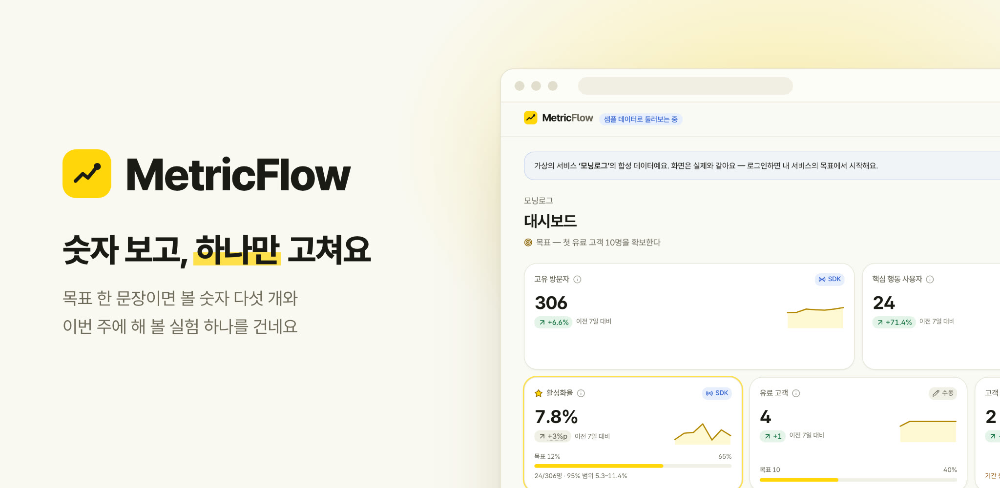

혼자 제품을 만드는 사람을 위한 성장 운영 도구입니다. 목표를 한 문장으로 적으면 지켜볼 숫자 다섯 개를 고르고, 쌓인 데이터만큼만 진단하고, 이번 주에 해 볼 실험 하나를 건넵니다. 데이터가 없으면 없다고 말합니다.

nanika를 닫고 기록을 정리해 보니 서비스별 방문자 수가 없었습니다. 여덟 개 중 무엇이 통했는지 답할 수 없었고, 그래서 이걸 만들기 시작했습니다. 첫 사용자는 저입니다.

  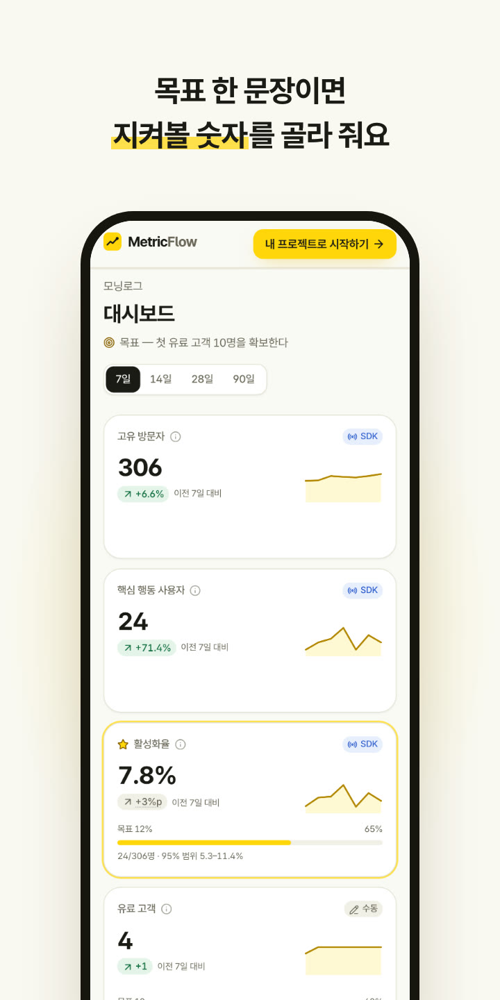
  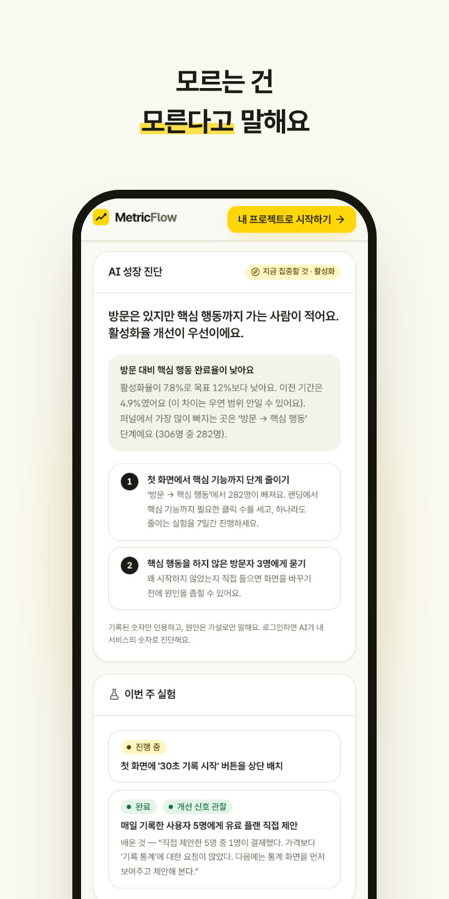
  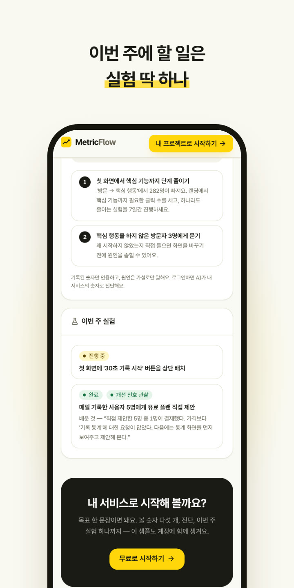

2026년 10월 시작 · Next.js · PostgreSQL · Claude · 화면 속 숫자는 데모용 합성 데이터

 

### vibing

  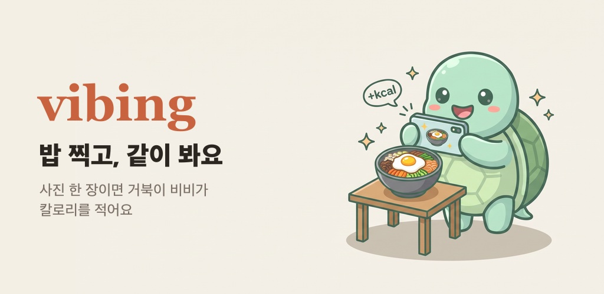

먹은 걸 사진 한 장으로 남기면 거북이 코치 **비비**가 칼로리를 적어 주고, 친구와 서로의 끼니를 같이 보는 감량 앱입니다. 감량·운동 앱으로는 열한 번째입니다.

  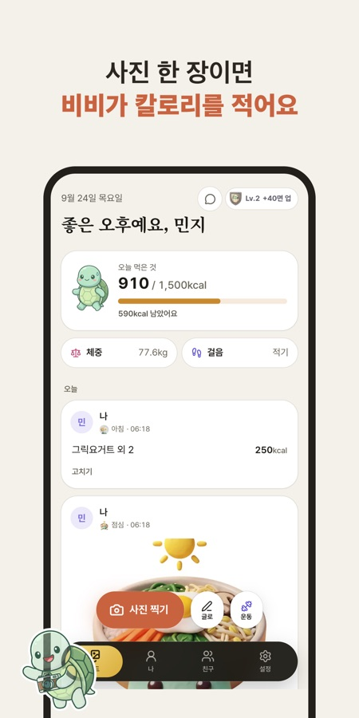
  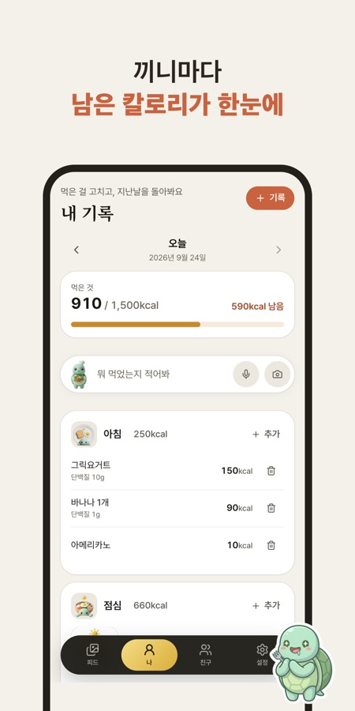
  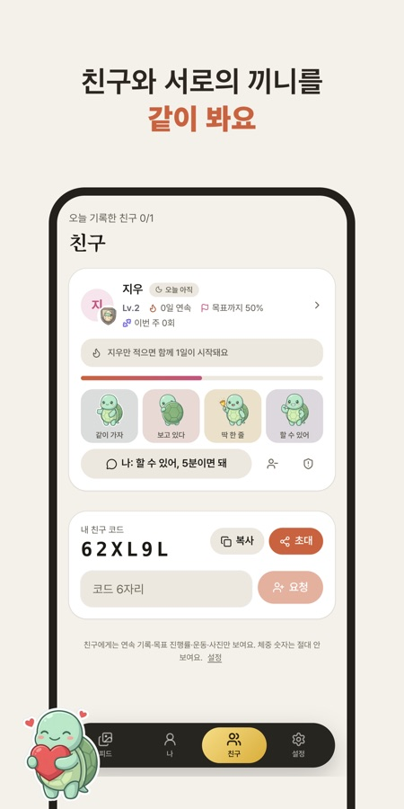

Next.js · Supabase · 앱스토어·구글 플레이 출시 준비 중

 

## nanika · 서비스 100개 만들기

하루에 하나씩 작은 웹 서비스를 만들어 인스타그램 릴스로 올리던 프로젝트입니다. 목표는 100개였고, 나흘 동안 여덟 개를 만든 뒤 문을 닫았습니다. 만든 건 전부 그대로 열어 두었으니 눌러서 해 보세요.

  <a href="https://wonjangcloud9.github.io/nanika/">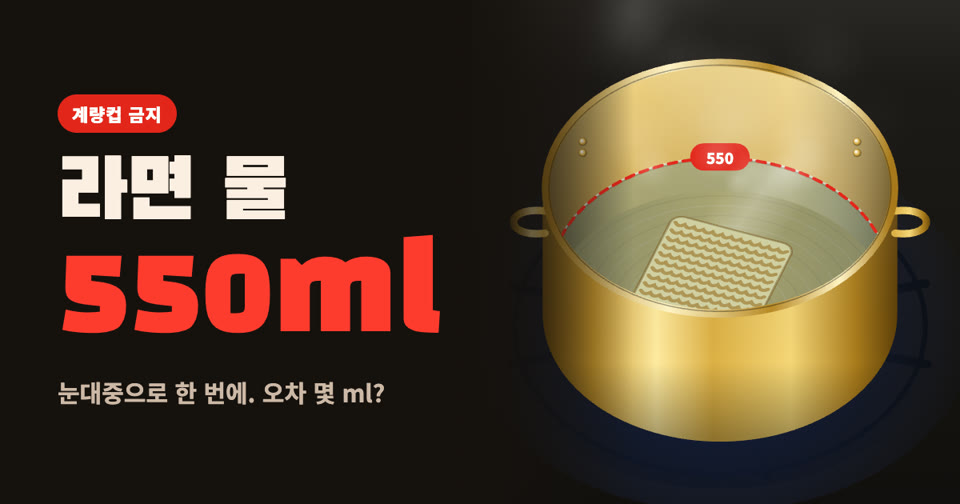</a>
  <a href="https://wonjangcloud9.github.io/nanika/subway/">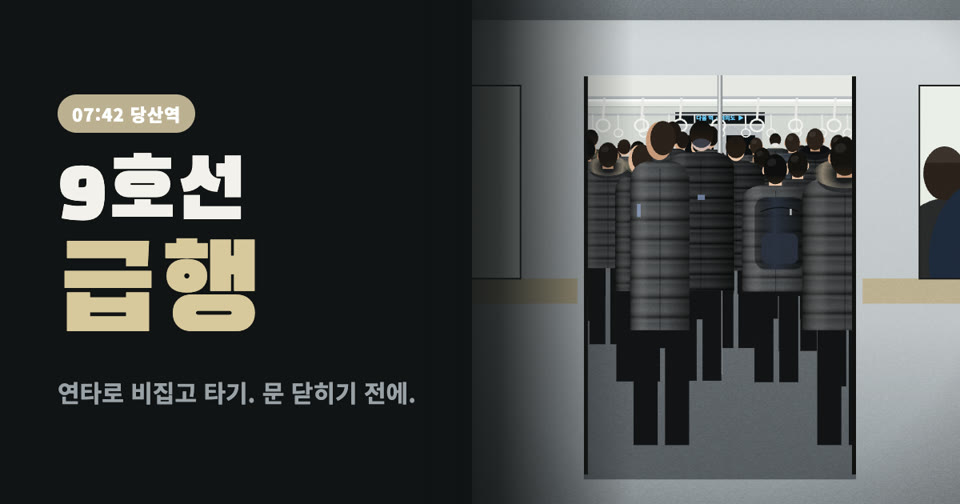</a>
  <a href="https://wonjangcloud9.github.io/nanika/tier/">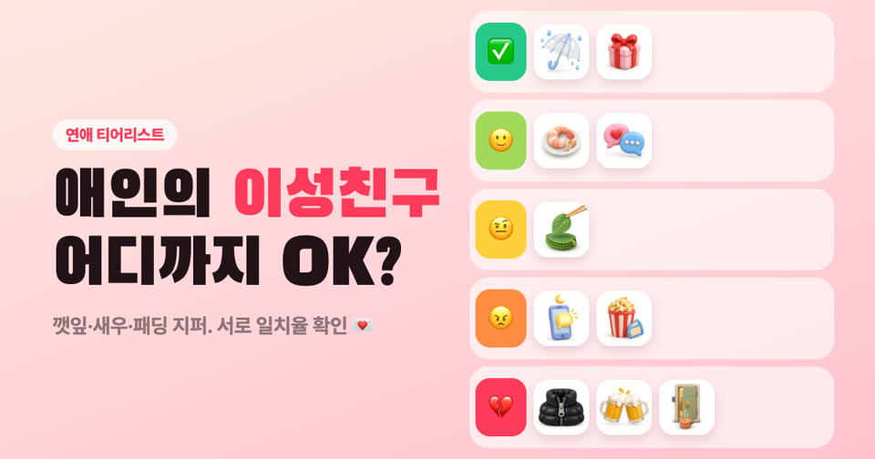</a>
  
  
  
  
  
  

가장 오래 붙든 건 #006 국보 박물관입니다. three.js로 3층 높이 홀과 전시실 열 곳을 짓고 국보 369점을 전부 걸었습니다.

2026년 9월 · 빌드 없는 HTML 한 장씩 · three.js · GitHub Pages

 

<b>오픈소스로 풀어 둔 도구 6개</b>

 

- **[notdone](https://github.com/wonjangcloud9/notdone)** 에이전트가 화면을 보지도 않고 "다 했어요"라고 할 때 증거를 요구하는 Claude Code 스킬
- **[wj-mods](https://github.com/wonjangcloud9/wj-mods)** 세션별 진행 상황, 사용량, 긴 작업 알림을 터미널에 붙이는 Claude Code 모드 모음
- **[claude-tree](https://github.com/wonjangcloud9/claude-tree)** Claude Code 세션을 git worktree로 나눠 여러 개 동시에 굴리는 CLI
- **[open-guardrail](https://github.com/wonjangcloud9/open-guardrail)** LLM 앱용 가드레일. API 호출 없이 0.1ms 안에
- **[wonjangAgent](https://github.com/wonjangcloud9/wonjangAgent)** 한국어 우선 자율 AI 에이전트. Rust 단일 바이너리
- **[harness-eval](https://github.com/wonjangcloud9/harness-eval)** 하네스가 결과를 얼마나 바꾸는지 숫자로 보는 CLI

 

## 지나온 길

<picture>
  <source media="(prefers-color-scheme: dark)" srcset="./assets/dashboard-dark-3ce2964fe4.svg">
  
</picture>

 

<table>
<tr><td width="92" align="center"><b>2019</b> 레포 2</td><td>
첫 커밋. 클론 코딩으로 시작했습니다 — 코코아톡, 넷플릭스.
</td></tr>
<tr><td align="center"><b>2020–21</b> 커밋 385</td><td>
깃허브를 쓰지 않던 시기. 중요한 줄 몰라서 코드가 로컬에만 쌓였습니다. 2020년 커밋 <b>0개</b>.
</td></tr>
<tr><td align="center"><b>2022</b> 레포 91 커밋 1,160</td><td>
React·Next.js·Django. 당근마켓, 에어비앤비, 트위터를 클론하며 한 달에 8개씩 레포를 열었습니다.
</td></tr>
<tr><td align="center"><b>2023</b> 레포 116 커밋 1,894</td><td>
<b>역대 최다 레포.</b> Flutter·React Native·Jetpack Compose를 동시에 다뤘고, 처음으로 제품을 시도했습니다 — 화장실 찾기, 교육 LMS, 민원 처리, AI 컴패니언.
</td></tr>
<tr><td align="center"><b>2024</b> 레포 48 커밋 1,314</td><td>
LangChain·RAG로 LLM을 처음 제품에 붙였습니다.
</td></tr>
<tr><td align="center"><b>2025</b> 레포 45 커밋 852</td><td>
건강·운동 앱을 다섯 개 만들었습니다. 후반엔 에이전트를 <b>직접 짜기 시작</b>했습니다.
</td></tr>
<tr><td align="center"><b>2026</b> 레포 41 커밋 2,728</td><td>
에이전트 도구를 npm과 PyPI에 올렸습니다. 9월엔 nanika로 나흘 동안 서비스 여덟 개를 열었고, 지금은 MetricFlow와 vibing을 만듭니다. <b>역대 최다 커밋, 아직 10월입니다.</b>
</td></tr>
</table>

## 오래 매달렸던 주제

<b>주제별로 몇 개, 어디까지 갔나</b>

 

| 주제 | 레포 | 어디까지 갔나 |
|---|---|---|
| 🤖 **에이전트·LLM** | 26개 | 강의 따라하기 → 직접 짜기 → **npm·PyPI 배포 4개** |
| 🏃 **감량·운동** | 11개 | 열한 번째가 vibing. 앞의 열 개가 뭘 빼야 하는지 알려줬습니다 |
| 🎌 **덕질·일본어** | 7개 | [custo](https://wonjangcloud9.github.io/custo/)로 정리됐습니다 |
| ⏱️ **포모도로** | 6개 | 새 프레임워크를 배울 때마다 하나씩 |
| 🎵 **틱톡 클론** | 3개 | Flutter 애니메이션은 여기서 익혔습니다 |
| 😴 **수면** | 3개 | [잠만보](https://life-save-with-claude-code-multi-se.vercel.app)가 남았습니다 |

한 주제를 오래 붙잡는 편입니다.

## 쓰는 것

TypeScript · Next.js · React · Python · Rust · Flutter · Supabase · PostgreSQL · three.js · Claude Code

 

<picture>
  <source media="(prefers-color-scheme: dark)" srcset="https://raw.githubusercontent.com/wonjangcloud9/wonjangcloud9/output/snake-dark.svg">
  
</picture>

레포 351개 중 <b>192개는 비공개</b>입니다 — 키나 개인 데이터가 들어 있어서요. 위 숫자는 비공개 커밋을 포함합니다.

